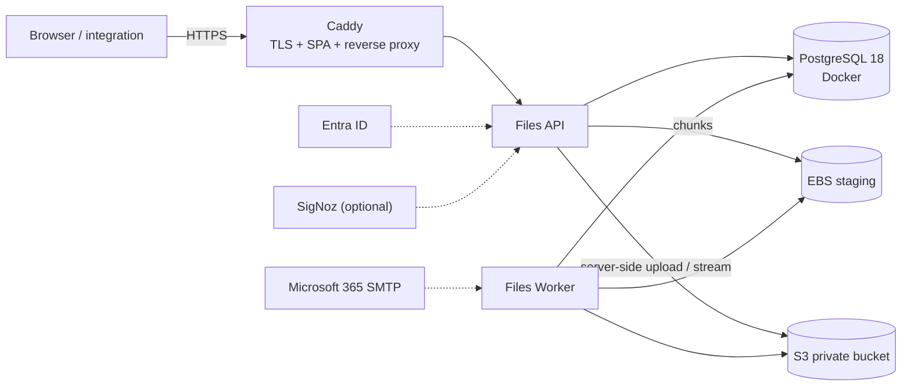

# Files

Secure file storage, transfer, and integration platform.

Files centralizes binary file storage in a **private Amazon S3 bucket** that **only Files can
access**, and exposes controlled operations to two kinds of consumers:

- **People** — upload, organize, retain, and share files through the Files Portal (Microsoft Entra
  ID).
- **Enterprise systems** — create, retrieve, check, and delete files through a versioned API using
  machine identities, without storing file contents in their own applications.

Public download links require an **8-character download key** in addition to an unguessable link
token. Integration-owned files are isolated, indefinitely retained by default, and accessible only
to their owner or explicitly granted integrations. Retention, expiration notifications, physical
deletion, and audits are managed by the platform.

> **Status (2026-10-23):** design and delivery package complete; application code not started.
> The initial deployment target is **one EC2 instance (Ubuntu 24.04) + one S3 bucket**, with
> Docker Compose, Caddy, and PostgreSQL 18 on the host. See the
> [roadmap](docs/09-delivery/roadmap.md) and [AGENTS.md](AGENTS.md) for the next session.
>
> **Resumen en español:** [docs/00-resumen-ejecutivo.md](docs/00-resumen-ejecutivo.md).

## Initial architecture



- No ALB, ECS, RDS, ECR, NAT gateway, or CloudWatch in this phase.
- The API/worker is the **only S3 client**; clients never receive presigned URLs or credentials.
  Infrastructure automation may manage bucket configuration but cannot read or write objects.
- Uploads are chunked through the API into local staging, verified, then uploaded to S3 by the API.
- Downloads stream from S3 through the API with short-lived, single-use grants.
- **ClamAV** scans staged files before they reach S3; infected files are quarantined.
- Nightly `pg_dump` backups go to `s3://<bucket>/backups/postgres/` (35 days); RPO 24 h/RTO 4 h.
- Production domain: `files.sacservices.cloud` (Network Solutions A record; Caddy TLS).

## Documentation

| Area | Document |
|---|---|
| Resumen ejecutivo (ES) | [00-resumen-ejecutivo.md](docs/00-resumen-ejecutivo.md) |
| Requirements (FR/NFR, IDs, invariants) | [requirements.md](docs/01-product/requirements.md) |
| User stories and acceptance criteria | [user-stories.md](docs/01-product/user-stories.md) |
| Roles and authorization matrix | [rbac-and-personas.md](docs/01-product/rbac-and-personas.md) |
| Decisions | [decisions.md](docs/01-product/decisions.md) |
| Open questions and defaults | [open-questions.md](docs/01-product/open-questions.md) |
| Glossary | [glossary.md](docs/01-product/glossary.md) |
| Architecture (C4, flows, deployment) | [architecture.md](docs/02-architecture/architecture.md) |
| Backend / frontend design | [backend-design.md](docs/02-architecture/backend-design.md) · [frontend-design.md](docs/02-architecture/frontend-design.md) |
| ADRs | [adr/](docs/02-architecture/adr/) |
| Data model | [data-model.md](docs/03-data/data-model.md) · [migrations](db/migrations/) |
| API conventions and errors | [api-conventions.md](docs/04-api/api-conventions.md) · [error-catalog.md](docs/04-api/error-catalog.md) |
| OpenAPI 3.1 contract | [files-api.v1.yaml](docs/04-api/openapi/files-api.v1.yaml) |
| Entra ID / machine identity / threat model | [entra-id-authentication.md](docs/05-security/entra-id-authentication.md) · [machine-identity-and-authorization.md](docs/05-security/machine-identity-and-authorization.md) · [threat-model.md](docs/05-security/threat-model.md) |
| Lifecycle, upload/download, retention | [file-lifecycle.md](docs/06-workflows/file-lifecycle.md) · [upload-and-download.md](docs/06-workflows/upload-and-download.md) · [retention-notifications-deletion.md](docs/06-workflows/retention-notifications-deletion.md) |
| Existing product backfill | [existing-product-migration.md](docs/06-workflows/existing-product-migration.md) |
| Testing strategy | [testing-strategy.md](docs/07-quality/testing-strategy.md) |
| Infrastructure, deployment, SLOs, cost, runbooks | [infrastructure-and-iac.md](docs/08-operations/infrastructure-and-iac.md) · [deployment-and-rollback.md](docs/08-operations/deployment-and-rollback.md) · [observability-and-slos.md](docs/08-operations/observability-and-slos.md) · [cost-model.md](docs/08-operations/cost-model.md) · [runbooks.md](docs/08-operations/runbooks.md) |
| Roadmap, backlog, traceability, session log | [roadmap.md](docs/09-delivery/roadmap.md) · [backlog.md](docs/09-delivery/backlog.md) · [traceability.md](docs/09-delivery/traceability.md) · [session-log.md](docs/09-delivery/session-log.md) |

## Repository layout

```
AGENTS.md                  # working agreement for future sessions
docs/                      # product, architecture, data, API, security, workflows, ops, delivery
db/migrations/             # canonical Flyway SQL (PostgreSQL 18)
infra/terraform/           # EC2 + Elastic IP + SG + IAM + S3 bucket/policy
deploy/                    # production Compose, Caddy, env template, backup/restore/smoke
infra/local/               # LocalStack S3 init and OTel collector for local development
scripts/                   # bootstrap and validation helpers
docker-compose.yml         # local dependencies
.github/workflows/ci.yml   # CI skeleton
```

## Local quickstart

Prerequisites: Docker, .NET SDK 10, Node.js 22 LTS (Angular 20 also supports 20.19+), Terraform
1.9+ (IaC only). ClamAV runs on the x86_64 production host; local development keeps scanning off.

```bash
cp .env.example .env          # review; local values are non-secret
docker compose up -d          # PostgreSQL 18, LocalStack S3, Mailpit, OTel Collector
docker compose --profile tools run --rm flyway migrate
```

| Service | URL / credentials |
|---|---|
| PostgreSQL | `localhost:5432` · db/user/password: `files` / `files` / `files` |
| LocalStack S3 API | `http://localhost:4566` · `test` / `test` · bucket `files-local` |
| LocalStack health | `http://localhost:4566/_localstack/health` |
| Mailpit (email UI) | `http://localhost:8025` (SMTP `localhost:1025`) |
| OTel Collector | `localhost:4317` (gRPC), `localhost:4318` (HTTP) |

The API and portal are not scaffolded yet. After S1:

```bash
dotnet run --project src/Files.Api     # http://localhost:8080
cd web && npm install && npm start     # http://localhost:4200
```

No S3 CORS is needed: the browser only talks to the API.

## Production deployment

Terraform creates (or imports) the EC2 instance, Elastic IP, security group, instance role, and
bucket. If the host/bucket already exist, import them or skip Terraform and apply the same policy
manually. Then follow [`deploy/README.md`](deploy/README.md):

1. Point DNS (e.g., `files.sacservices.cloud`) at the Elastic IP.
2. Copy `deploy/` to `/opt/files/app`, create `/opt/files/.env` (mode 0600).
3. Start PostgreSQL, run Flyway, build the SPA, start API/worker/Caddy.
4. Install the nightly backup cron and verify a dump in S3.
5. Run `deploy/smoke.sh`.

TLS requires a DNS name; Caddy obtains the certificate automatically. A bare public IP cannot get
a trusted certificate (OQ-15).

## Validation

```bash
make validate          # docs links/IDs, OpenAPI lint, compose config, Terraform fmt
make db-verify         # apply migrations to a throwaway PostgreSQL 18 container
cd infra/terraform && terraform init -backend=false && terraform validate
```

## Core decisions at a glance

- **.NET 10 modular monolith + worker**, Angular + Bootstrap portal, PostgreSQL 18, EF Core +
  Dapper, Quartz in-memory scheduler with PG advisory locks.
- **API-only S3**: chunked uploads to local staging then server-side multipart; downloads streamed
  with 120-second single-use grants; no presigned URLs anywhere.
- **Links**: public 256-bit token + 8-character key (Argon2id), 15-day TTL; private links
  30 days with an ACL of Entra users/groups or all-tenant; TTLs are admin-defined, not owner-set.
- **Retention** is explicit finite/indefinite: human default 30 days, absolute max 365 days, a
  mandatory note to extend above the default, and no indefinite human files; legal hold blocks
  expiry/deletion. Audit is retained 60 months and downloads 24 months.
- **Integration files** are private, indefinitely retained; cross-integration access requires an
  explicit read-only grant.
- **Entra ID** for humans (OIDC + PKCE, app roles) and **client credentials only** for machines;
  Files does not issue API keys.
- **Bilingual UI** (Spanish default, English selector); emails use the recipient locale.
- **Single-node deployment** (D-31): 99.5% best-effort, nightly logical backups, documented
  scale-up path to RDS/ECS/ALB when construction ends.

## License

Proprietary. All rights reserved.
