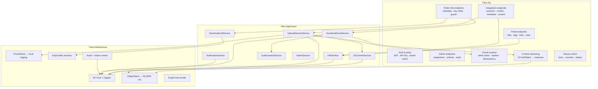
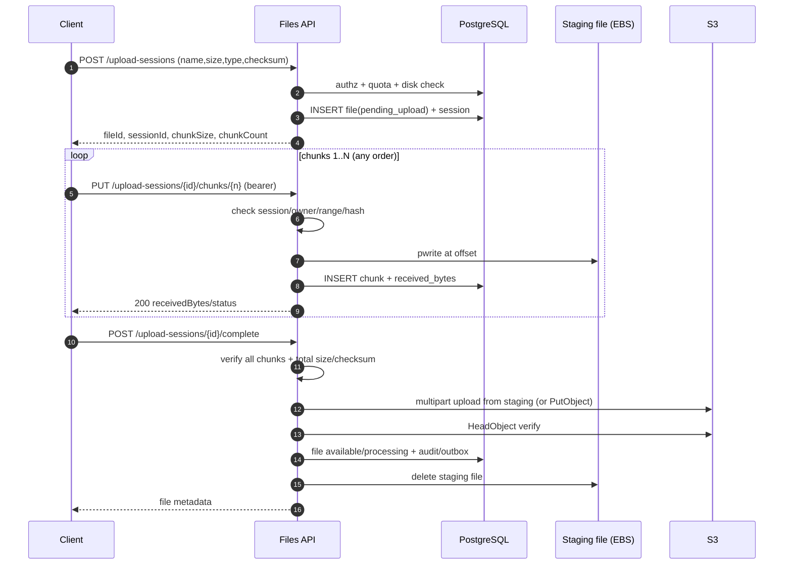
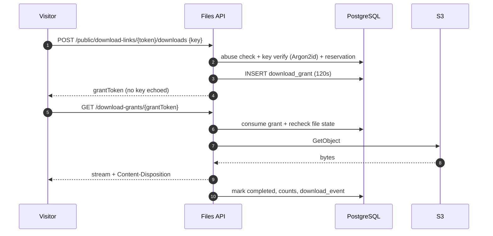

# Architecture — Single-Node Initial Phase

**Status:** Baseline for the construction phase · **Decisions:** `docs/02-architecture/adr/` ·
**Domain:** `docs/03-data/data-model.md`

## 1. Principles

1. **Private by default.** S3 is never public, and only Files can touch it.
2. **The API is the only S3 client.** Browsers, integrations, and humans never receive S3 URLs,
   keys, or credentials.
3. **Control plane ≠ data plane.** Metadata and authorization are small requests; uploads are
   chunked through the API into a local staging file, and downloads stream from S3 through the API.
4. **The database is the source of truth.** S3 stores blobs; consistency is reconciled.
5. **Idempotency everywhere.** Chunks, completion, jobs, and retries are safe.
6. **Least privilege.** One EC2 instance role with prefix-scoped S3 access and a deny-all bucket
   policy; the public surface is Caddy only.
7. **Observable and auditable.** Traces, metrics, and audit events; honest single-node SLOs.

## 2. System context (C4 level 1)

```mermaid
flowchart LR
  human["Tenant employee<br/>(browser)"]
  visitor["Link visitor<br/>(browser, no account)"]
  consumer["Existing enterprise product<br/>(backend integration)"]
  entra["Microsoft Entra ID"]
  mail["Microsoft 365<br/>(Graph sendMail)"]
  signoz["SigNoz (self-hosted or external)<br/>OTLP"]

  subgraph aws["AWS account (construction phase)"]
    subgraph ec2["Single EC2 · Ubuntu 24.04 · Elastic IP"]
      caddy["Caddy<br/>TLS · reverse proxy · SPA"]
      api["Files API<br/>.NET 10"]
      worker["Files Worker<br/>.NET 10"]
      db[("PostgreSQL 18<br/>Docker, EBS")]
      staging[("Staging volume<br/>EBS")]
    end
    s3[("Amazon S3<br/>private bucket")]
  end

  human -->|HTTPS| caddy
  visitor -->|HTTPS /d/{token}| caddy
  consumer -->|HTTPS| caddy
  caddy --> api
  caddy -->|static| human
  api --> db
  worker --> db
  api -->|chunks / reads| staging
  worker -->|cleanup| staging
  api -->|server-side upload / stream| s3
  worker -->|delete / reconcile| s3
  api -.->|OIDC validate| entra
  human -->|OIDC PKCE| entra
  consumer -->|client credentials| entra
  worker -->|sendMail| mail
  api -.->|OTLP| signoz
  worker -.->|OTLP| signoz
```

External dependencies: Microsoft Entra ID (human/machine identity), Microsoft Graph (email),
Amazon S3 (blobs), SigNoz (telemetry; self-hosted or external).

## 3. Container view (C4 level 2)

```mermaid
flowchart TB
  internet["Internet / Elastic IP"]
  subgraph host["EC2 instance (Ubuntu 24.04, Docker Compose)"]
    subgraph edge["Edge container"]
      caddy["Caddy 2.x<br/>:80/:443 · automatic TLS<br/>SPA static + /v1,/health proxy"]
    end
    subgraph app["Application containers"]
      api["Files API<br/>chunk staging · auth · metadata · streaming"]
      worker["Files Worker<br/>jobs · outbox · cleanup"]
    end
    subgraph data["Data"]
      pg[("PostgreSQL 18<br/>container · EBS volume")]
      staging[("Staging directory<br/>EBS")]
    end
    subgraph obs["Optional"]
      otel["OTel Collector"]
    end
  end
  s3[("S3 private bucket")]
  graph["Graph API"]
  entra["Entra ID"]

  internet --> caddy
  caddy --> api
  caddy -->|static files| internet
  api --> pg
  worker --> pg
  api --> staging
  worker --> staging
  api -->|instance role| s3
  worker -->|instance role| s3
  worker --> graph
  api -.-> entra
  api -.-> otel
  worker -.-> otel
```

| Container | Responsibility | Exposure |
|---|---|---|
| Caddy | TLS, HTTP→HTTPS, static SPA, reverse proxy, body-size limit, security headers. | 80/443 public. |
| Files API | AuthN/Z, metadata, chunk staging, S3 upload/stream, audit, admin. | Internal Docker network only. |
| Files Worker | Notifications, expiration, deletion, cleanup, reconciliation, outbox. | None. |
| PostgreSQL 18 | Metadata, policies, audit, outbox, idempotency. | Internal only; no host port. |
| OTel Collector | OTLP export to SigNoz. | Internal (optional). |

The host also runs a `pg_dump` backup job (cron/systemd timer) that writes to
`s3://<bucket>/backups/postgres/` using the same instance role. No other AWS services are used.

## 4. API components (C4 level 3)



Dependency rule: `Api → Application → Domain`, `Infrastructure → Application/Domain`; Domain has
no framework references. The API composes everything via DI.

## 5. Worker components

| Component | Schedule | Responsibility |
|---|---|---|
| Outbox dispatcher | every 2 s | Dispatch committed events (email, audit projections, metrics). |
| Notification scheduler | hourly | Compute due notifications per interval; upsert unique events. |
| Notification sender | every minute | Send via Graph with retries; record accepted/failed. |
| Expiration job | every 15 min | `available` → `pending_deletion` after expiry; revoke links. |
| Deletion job | every 5 min | Delete S3 object, mark `deleted`; retry failures. |
| Grant expiry | every minute | Expire grants and release download reservations. |
| Link expiry | every 15 min | Mark active links past expiry. |
| Upload cleanup | every 10 min | Delete expired staging files, abort stale multipart uploads, mark sessions failed. |
| Reconciliation | daily | Compare DB and S3; quarantine missing objects; move orphans to `orphan/`. |
| Retention purge | daily | Purge events/tombstones/idempotency rows per policy. |
| Backup verification | daily | Check the latest `pg_dump` in S3 exists and is non-empty; alert otherwise. |

Every job: batch-limited (default 500), wrapped in `pg_try_advisory_lock(<job-key>)`, resumable,
and emits `job_runs_total{job,result}` and duration metrics. On a single node the lock is mostly a
safety net for overlapping cron ticks.

## 6. Control plane vs data plane

| Operation | Path | Authorization point | Notes |
|---|---|---|---|
| Create upload session | Client → API | Before staging file | Small JSON; no S3. |
| Upload chunk | Client → API → staging file | Every request | 16 MiB max; idempotent. |
| Complete upload | Client → API → S3 | Session owner + verification | API does multipart/PutObject; HeadObject. |
| Download | Client ↔ API ↔ S3 | Per request/grant | Streamed, counted, audited. |
| Public link | Visitor → API (grant) → API stream | Key + link + file checks | Grant 120 s, single use. |
| Delete/expire | Worker → S3 | System job + DB state | Idempotent. |
| Backup | Host cron → `pg_dump` → S3 | Instance role | Nightly; lifecycle 35 days. |

**Why the API proxies both directions:** S3 exclusivity (D-30), completion-based counting, audit,
and immediate revocation. The trade-off is EC2 bandwidth/disk, accepted for the construction
phase (ADR-0003, ADR-0010).

## 7. Key flows

### 7.1 Chunked upload (portal or integration)



If the S3 commit fails, the session stays `failed` with the staging file intact; retrying
`complete` reattempts S3 without client re-upload. Expired sessions are cleaned by the worker.

### 7.2 Public link download



### 7.3 Integration metadata/content

`GET /v1/integrations/files/{fileId}` and `/content` authorize ownership or an explicit read grant,
recheck the file predicate, stream from S3, and audit. No S3 URL is returned.

### 7.4 Expiration and deletion

See [file-lifecycle.md](../06-workflows/file-lifecycle.md) and
[retention-notifications-deletion.md](../06-workflows/retention-notifications-deletion.md).

## 8. Deployment topology

```mermaid
flowchart TB
  dns["DNS name (required for TLS)"] --> eip["Elastic IP"]
  eip --> sg["Security group<br/>80/443 world · 22 admin CIDR"]
  sg --> ec2["EC2 · Ubuntu 24.04 · t3.medium<br/>100 GiB gp3 EBS"]
  subgraph ec2box["Docker Compose"]
    caddy["Caddy :80/:443"] --> api["API :8080"]
    api --> pg[("PostgreSQL 18")]
    api --> staging[("Staging dir")]
    worker["Worker"] --> pg
    worker --> staging
  end
  ec2 --> ec2box
  api -->|instance role| s3[("S3 bucket")]
  worker -->|instance role| s3
  cron["Host cron: pg_dump"] -->|instance role| s3
  api -.->|OTLP| signoz["SigNoz"]
  worker -.->|OTLP| signoz
  ec2 -->|443| entra["Entra ID"]
  ec2 -->|443| graph["Graph"]
```

- The API and PostgreSQL are not reachable from the internet; Caddy is the only listener.
- The Elastic IP keeps the public address stable across instance stop/start (within the account).
- DNS/TLS is a hard prerequisite for public launch; the domain points to the Elastic IP and Caddy
  obtains the certificate. A bare IP cannot get a trusted certificate (OQ-15).
- SSH is restricted to `admin_cidr`; IMDSv2 is required; UFW mirrors the security group.

## 9. Trust boundaries

| Boundary | Crosses | Control |
|---|---|---|
| Internet ↔ Caddy | Untrusted | TLS 1.2/1.3, request size limits, headers, rate limiting at the API. |
| Caddy ↔ API | Local Docker network | No published API port; `ForwardedHeaders` only from Caddy. |
| API/Worker ↔ PostgreSQL | Docker network | Strong password, no host port, least-privilege DB role. |
| API/Worker ↔ S3 | IAM instance role | Prefix-scoped identity policy + bucket policy deny-all-except-role; TLS. |
| Worker ↔ Graph | Outbound HTTPS | App permission restricted to one mailbox. |
| Host ↔ operator | SSH | Restricted CIDR, key auth, fail2ban, no password login. |
| Public visitor ↔ API | Untrusted | Token + key + throttling; generic errors. |

## 10. Technology baseline

| Layer | Choice | Version policy |
|---|---|---|
| API / Worker | C# / .NET | .NET 10 LTS (pinned in `global.json`). |
| Web | Angular, TypeScript, Bootstrap | Angular LTS, Bootstrap 5.3.x, Node 22 LTS. |
| Data access | EF Core + Npgsql; Dapper for atomic SQL | EF Core 10.x. |
| DB | PostgreSQL (Docker container, EBS volume) | 18.x. |
| Object storage | AWS S3 SDK v4 (LocalStack S3 locally) | AWS SDK for .NET v4. |
| Edge | Caddy | 2.8.x. |
| Orchestration | Docker Engine + Compose plugin | Ubuntu 24.04 packages. |
| Host | EC2 + gp3 EBS + Elastic IP | Ubuntu 24.04 LTS. |
| Auth | Microsoft.Identity.Web / JwtBearer; MSAL Angular | Latest stable compatible. |
| Jobs | Quartz.NET, in-memory scheduler + PG advisory locks | 3.x. |
| Email | Microsoft Graph SDK (`sendMail`) | Latest stable. |
| Telemetry | OpenTelemetry .NET → OTLP → SigNoz (optional self-hosted) | Latest stable. |
| IaC | Terraform | ≥1.9 (repo tested with 1.13). |

## 11. Cross-cutting concerns

- **Configuration:** strongly typed options bound from environment (`Files__*`); validated at
  startup; secrets never logged.
- **Errors:** RFC 9457 problem+json with stable codes and trace ID; no stack traces to clients.
- **Validation:** FluentValidation at the edge + domain invariants; 422 for semantic errors.
- **Concurrency:** optimistic `version`/ETag for metadata; atomic SQL for reservations/counters;
  chunk writes use `pwrite` with a per-chunk unique key.
- **Time:** inject `TimeProvider`; persist UTC; expiry compares DB `now()`.
- **Logging:** structured JSON with request/trace ID; redact `Authorization`, chunk bodies, keys,
  tokens, filenames; access logs disabled for token-bearing paths (threat model I-11).
- **Telemetry:** OTel traces (ASP.NET, HttpClient, EF Core, S3), RED + business metrics; SigNoz
  optional but recommended externally if host resources are tight.
- **Resilience:** retries with exponential backoff for S3/Graph; circuit breaker for Graph;
  timeouts; upload sessions survive client disconnects; S3 commit retries reuse staging.
- **Data protection:** Argon2id for link keys, HMAC-SHA256 for API keys, SHA-256 for link/grant
  tokens; SSE-S3 at rest; TLS in transit.

## 12. Scale-up path (not part of the initial phase)

1. Move PostgreSQL to RDS (PITR, Multi-AZ) and back up with the managed service.
2. Run the API on ECS/ALB or multiple EC2 instances behind a load balancer; move session state
   out of local staging (S3 multipart from the API, or shared storage) and decide whether to
   reintroduce direct-to-S3 uploads with a revised exclusivity model.
3. Add CloudWatch/WAF/Route 53 (or keep Caddy with DNS), centralized logs, and SigNoz.
4. Revisit S3 versioning/replication and the erasure wording.
