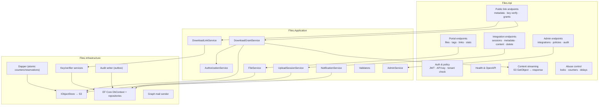
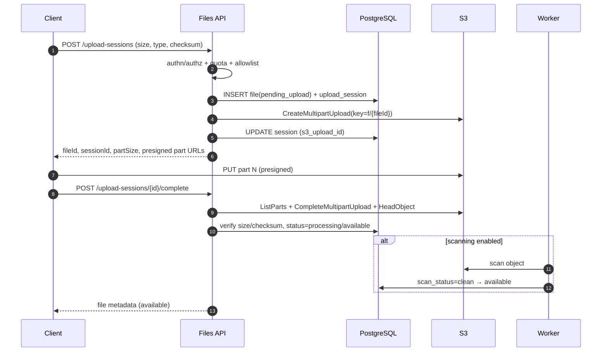
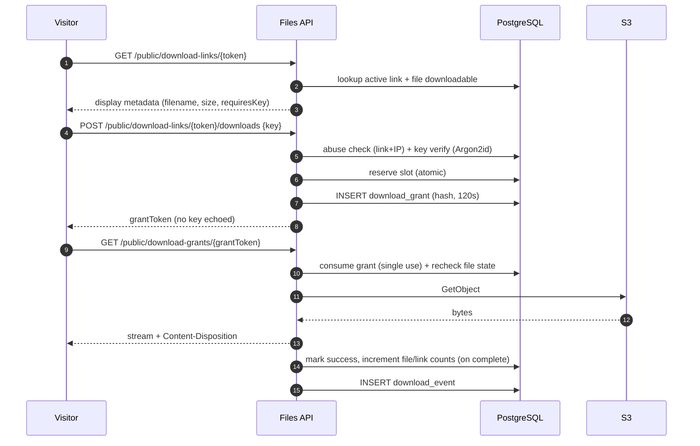
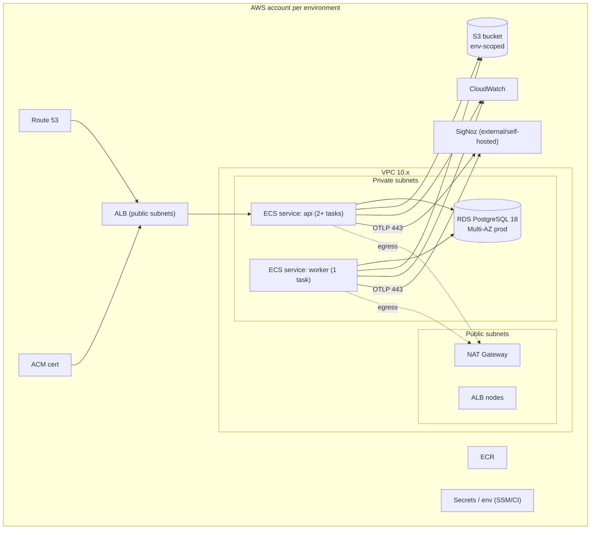

# Architecture

**Status:** Baseline (v1) · **Decisions:** `docs/02-architecture/adr/` · **Domain:** `docs/03-data/data-model.md`

## 1. Principles

1. **Private by default.** S3 is never public; every byte passes an authorization decision.
2. **Control plane ≠ data plane.** Metadata, auth, policy, and audit are small requests; large
   byte transfers go directly to S3 (uploads) or stream through a dedicated path (downloads).
3. **The database is the source of truth.** S3 is a blob store; consistency is reconciled.
4. **Idempotency everywhere.** Retries, jobs, and duplicate messages must be harmless.
5. **Least privilege.** Separate IAM roles, per-integration permissions, no admin content access.
6. **Observable by default.** Every request is traced, every job emits metrics, every decision
   is auditable.
7. **Boring, maintainable technology.** A modular monolith and a worker, not microservices.

## 2. System context (C4 level 1)

```mermaid
flowchart LR
  human["Tenant employee<br/>(browser)"]
  visitor["Link visitor<br/>(browser, no account)"]
  consumer["Existing enterprise product<br/>(backend integration)"]
  entra["Microsoft Entra ID"]
  mail["Microsoft 365<br/>(Graph sendMail)"]
  signoz["SigNoz<br/>(OTLP)"]

  subgraph files["Files platform"]
    portal["Files Portal<br/>(Angular)"]
    api["Files API<br/>(.NET 10)"]
    worker["Files Worker<br/>(.NET 10)"]
    db[("PostgreSQL 18")]
    s3[("Amazon S3<br/>private bucket")]
  end

  human -->|HTTPS| portal
  visitor -->|HTTPS /d/{token}| portal
  portal -->|OIDC PKCE| entra
  portal -->|REST + Bearer| api
  consumer -->|OAuth2 client credentials| entra
  consumer -->|REST + Bearer| api
  api --> db
  worker --> db
  api --> s3
  worker --> s3
  worker --> mail
  api -.->|OTLP| signoz
  worker -.->|OTLP| signoz
```

External systems:

| System | Role | Failure behavior |
|---|---|---|
| Microsoft Entra ID | Human SSO, app roles, machine tokens | Outage blocks new logins/token acquisition; existing tokens up to 1 h keep working. |
| Microsoft 365 / Graph | Expiration emails | Notifications retried; expiration/deletion continue. |
| Amazon S3 | Blob storage + presigned uploads | Uploads/downloads fail; metadata remains consistent; jobs retry. |
| SigNoz (OTLP) | Traces, metrics, logs | Non-blocking; buffered/limited export. |

## 3. Container view (C4 level 2)

```mermaid
flowchart TB
  subgraph edge["Edge"]
    alb["ALB + TLS + WAF (optional)"]
  end

  subgraph web["Web tier"]
    spa["Files Portal SPA<br/>Angular + Bootstrap + MSAL"]
  end

  subgraph app["Application tier (ECS Fargate)"]
    api["Files API<br/>ASP.NET Core minimal APIs"]
    worker["Files Worker<br/>scheduler + outbox dispatcher"]
  end

  subgraph data["Data tier"]
    pg[("RDS PostgreSQL 18")]
  end

  subgraph aws["AWS managed"]
    s3[("S3 private bucket<br/>SSE, BPA, lifecycle")]
    ecr["ECR"]
    cw["CloudWatch Logs"]
  end

  idp["Entra ID"]
  graph["Graph API"]
  otel["OTel Collector → SigNoz"]

  alb --> spa
  alb --> api
  spa -->|REST| api
  spa -->|MSAL| idp
  api --> pg
  worker --> pg
  api -->|presign / stream| s3
  worker -->|delete / scan / reconcile| s3
  worker -->|sendMail| graph
  api --> ecr
  worker --> ecr
  api --> cw
  worker --> cw
  api -.-> otel
  worker -.-> otel
```

| Container | Responsibility | Scale |
|---|---|---|
| Portal SPA | UI, MSAL session, upload orchestration, link management, admin UI. | Static/CDN; no state. |
| Files API | AuthN/Z, metadata, link/key verification, upload session control, streaming downloads, admin, audit. | 2+ tasks, stateless (except streaming), autoscale on CPU/RPS. |
| Files Worker | Notifications, expiry, deletion, reconciliation, cleanup, outbox. | 1–2 tasks; single execution enforced per job. |
| PostgreSQL | Metadata, policies, audit, outbox, idempotency, reservations. | Multi-AZ prod. |
| S3 | Blob content, staging, quarantine; lifecycle cleanup. | Managed. |

## 4. API components (C4 level 3)



Dependency rule: `Api → Application → Domain`, `Infrastructure → Application/Domain`; Domain has
no framework references. `Api` composes everything via DI.

## 5. Worker components

| Component | Schedule | Responsibility |
|---|---|---|
| Outbox dispatcher | every 2 s (poll) | Dispatch committed events to handlers (email enqueue, audit projections, metrics). |
| Notification scheduler | hourly | Compute due notifications for each interval; upsert `notification_events`. |
| Notification sender | every minute | Send pending emails with retries/backoff; record accepted/failed. |
| Expiration job | every 15 min | `available` → `expired` → `pending_deletion` when `expires_at <= now()`. |
| Deletion job | every 5 min | Delete S3 object, mark `deleted`; retry failures with backoff. |
| Grant expiry | every minute | Expire unredeemed/partially served grants and release their download reservations. |
| Link expiry | every 15 min | Mark active links with `expires_at <= now()` as `expired`. |
| Upload cleanup | hourly | Abort multipart > 24 h; expire `pending_upload`; purge staging. |
| Reconciliation | daily | Compare DB vs S3; flag missing/orphan objects; quarantine and alert. |
| Retention purge | daily | Purge data past retention (events, tombstones) and idempotency records. |

Every job: batch-limited (default 500), wrapped in `pg_try_advisory_lock(<job-key>)`, resumable,
emits `job_runs_total{job,result}` and duration metrics. See
[retention-notifications-deletion.md](../06-workflows/retention-notifications-deletion.md).

## 6. Control plane vs data plane

| Operation | Path | Authorization point | Notes |
|---|---|---|---|
| Create upload session | Portal/API → DB + S3 `CreateMultipartUpload` | Before presigning | Small payload. |
| Upload parts | Browser/integration → S3 directly | Presigned URL scope + expiry | No API bytes. |
| Complete upload | Client → API | Session ownership + S3 verification | ListParts/HeadObject. |
| Download (portal/integration) | Client ↔ API ↔ S3 | API, per request | Streamed, counted, audited. |
| Download (link) | Visitor → API (grant) → API stream | Key + link + file checks | Grant 120 s, single use. |
| Delete/expire | Worker → S3 | System job + DB state | Idempotent. |

**Why downloads stream through the API:** the spec requires counting only completed downloads,
auditing every attempt, immediate revocation, and not exposing permanent URLs. Presigned S3 GET
URLs cannot provide post-issuance enforcement or completion accounting. Uploads are different:
presigned URLs are required for 5 GiB and are safe because the object key is fixed and verified
on completion.

## 7. Key flows

### 7.1 Direct multipart upload (portal or integration)



### 7.2 Public link download



### 7.3 Portal private link

The same grant flow, but issuance requires an Entra bearer token and the grant is attributed to
the user; the token is not required at redemption (the grant is a short-lived bearer capability
so the browser can navigate to the stream). Redemption rechecks the file state, is single-use,
and the audit event records the user.

### 7.4 Integration content download

`GET /v1/integrations/files/{fileId}/content` → authorize (ownership or grant) → recheck file
state → stream from S3 with optional `Range` → count on completion → audit. No link or key is
involved. Denials are audited and return 404 `file_not_found`/`file_unavailable`.

### 7.5 Expiration and deletion

See [file-lifecycle.md](../06-workflows/file-lifecycle.md) and
[retention-notifications-deletion.md](../06-workflows/retention-notifications-deletion.md).

## 8. Deployment topology



- API tasks are private; only the ALB is public. S3 access uses a task IAM role (no keys).
- The worker has a separate task role limited to `DeleteObject`, `GetObject`, `ListBucket`
  (prefix-scoped), and `ListMultipartUploads`/`AbortMultipartUpload`.
- The API task role can `PutObject`/`GetObject`/`DeleteObject` on `f/*`, `staging/*`, and
  multipart operations on `f/*`, but cannot delete bucket policy or change BPA.
- Outbound 443 allowed to Entra, Graph, S3, and SigNoz only.

## 9. Trust boundaries

| Boundary | Crosses | Control |
|---|---|---|
| Browser ↔ API | Untrusted | TLS, OIDC tokens, CSRF-safe APIs, CORS allowlist, input validation. |
| Portal SPA ↔ Entra | Untrusted | PKCE public client, no secret in SPA. |
| Integration ↔ API | Semi-trusted enterprise | mTLS not required; OAuth2/API key + IP allowlist + quotas. |
| API/Worker ↔ S3 | Trusted (IAM) | Task role scoped by prefix and action; TLS; SSE. |
| API/Worker ↔ DB | Trusted (VPC) | Private subnets, TLS to RDS, least-privilege DB role. |
| Worker ↔ Graph | Trusted | App permission restricted to one mailbox via application access policy. |
| Public visitor ↔ API | Untrusted | Token + key + throttling; generic errors; no enumeration oracle. |

## 10. Technology baseline

| Layer | Choice | Version policy |
|---|---|---|
| API / Worker | C# / .NET | .NET 10 LTS (pinned in `global.json`). |
| Web | Angular, TypeScript, Bootstrap | Angular LTS at scaffold, Bootstrap 5.3.x, Node 20.19+/22 LTS. |
| Data access | EF Core + Npgsql; Dapper for atomic SQL | EF Core 10.x. |
| DB | PostgreSQL | 18.x (RDS). |
| Object storage | AWS S3 SDK v4 (or LocalStack/LocalStack S3 for local) | AWS SDK for .NET v4. |
| Auth | Microsoft.Identity.Web / JwtBearer; MSAL Angular | Latest stable compatible. |
| Jobs | Quartz.NET, in-memory scheduler + PG advisory locks | 3.x. |
| Email | Microsoft Graph SDK (`sendMail`) | Latest stable. |
| Telemetry | OpenTelemetry .NET → OTLP → SigNoz | Latest stable. |
| IaC | Terraform | ≥1.9 (repo tested with 1.13). |
| Containers | Docker; ECS Fargate | — |

## 11. Cross-cutting concerns

- **Configuration:** strongly typed options bound from environment (`Files__*`), validated at
  startup (`ValidateOnStart`); secrets never logged.
- **Errors:** RFC 9457 problem+json with stable codes and trace ID; no stack traces to clients.
- **Validation:** FluentValidation at the edge + domain invariants; 422 for semantic errors.
- **Concurrency:** optimistic concurrency (`version`/ETag) for metadata; atomic SQL for link
  reservations and counters.
- **Time:** inject `TimeProvider`; all persisted times UTC; expiry compares DB `now()`.
- **Logging:** structured (Serilog or built-in JSON), scoped with request/trace ID; redaction of
  `Authorization`, `key`, `token`, and set-cookie headers.
- **Telemetry:** OTel traces (ASP.NET, HttpClient, EF Core, S3), metrics (RED + business),
  logs with trace correlation.
- **Resilience:** S3/Graph retries with exponential backoff and jitter, circuit breaker for
  Graph, timeouts everywhere; no retry for 4xx.
- **Data protection:** Argon2id (libsodium/Konscious) for link keys; HMAC-SHA256 peppered for
  API keys; SHA-256 for grant/link tokens (high entropy, one-way).

## 12. Explicit non-decisions / future work

- Multi-tenancy (OQ-03) would add `tenant_id` to ownership tables and per-tenant policy.
- Direct presigned downloads (to remove API egress) would require a different counting model.
- Redis can replace the Postgres abuse counters when traffic justifies it.
- A CDN in front of downloads is deferred until egress cost or global latency demands it.
