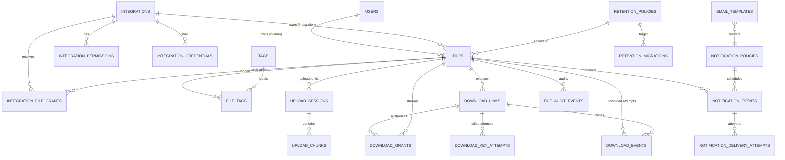

# Data Model

**Canonical DDL:** [`db/migrations/V1__initial_schema.sql`](../../db/migrations/V1__initial_schema.sql)
**Reference data:** [`V2__seed_reference_data.sql`](../../db/migrations/V2__seed_reference_data.sql)
**DB:** PostgreSQL 18 · **PK:** UUIDv7 · **Time:** `timestamptz` UTC · **Enums:** `text` + `CHECK`

## 1. Entity-relationship overview



`DOWNLOAD_EVENTS` also reference `GRANTS`. `OUTBOX_MESSAGES`, `IDEMPOTENCY_RECORDS`,
`DAILY_USAGE`, `ABUSE_LOCKOUTS`, `PLATFORM_SETTINGS`, and `ADMIN_AUDIT_EVENTS` are operational
tables without aggregate relationships.

## 2. Table catalog

### Identity and access

| Table | Purpose | Key constraints |
|---|---|---|
| `users` | Entra human identities (`tenant_id`, `object_id`). | `UNIQUE (tenant_id, object_id)`; `status` active/disabled. |
| `integrations` | Registered machine consumers. | `UNIQUE slug`, `UNIQUE entra_client_id`; status consistency with `disabled_at`; CIDR allowlist. |
| `integration_permissions` | Explicit permissions per integration. | PK (`integration_id`, `permission`); values `file.write`, `file.read`, `file.delete`. |
| `integration_credentials` | API keys and Entra client identities. | Shape check per credential type; `key_id` unique; only verifier stored; `hash_key_version` for pepper rotation; rotation link. |
| `integration_file_grants` | Explicit read-only cross-integration access. | Partial unique active (`file_id`, `integration_id`); only integration-owned files may be granted. |

### Files and organization

| Table | Purpose | Key constraints |
|---|---|---|
| `files` | File metadata, ownership, storage reference, lifecycle, retention, stats. | Owner XOR; retention mode/expiry consistency; deleted iff `deleted_at`; integration ⇒ `integration_only`; unique `storage_key`. |
| `tags` | Reusable tags, global or per-user. | `UNIQUE NULLS NOT DISTINCT (scope, owner_user_id, name)` (case-insensitive via `citext`). |
| `file_tags` | File ↔ tag. | PK (`file_id`, `tag_id`), cascade. |
| `upload_sessions` | Upload intent, expected size/type/checksum, chunk geometry, local staging path, S3 upload ID, state. | One per file (`UNIQUE file_id`); unique `staging_path`; `received_bytes <= expected_size_bytes`; status/expiry. |
| `upload_chunks` | Chunks received by the API into the staging file. | PK (`upload_session_id`, `chunk_number`); offset/size/hash. |
| `retention_policies` | Versioned global retention configuration. | One active (partial unique); `max_days >= default_days`. |
| `notification_policies` | Versioned intervals and template key. | One active; intervals 1–10 positive values. |
| `email_templates` | Versioned subject/HTML/text per key+locale. | One active per key+locale; version unique. |
| `retention_migrations` | Progress of admin bulk retention changes. | Target policy FK, reason required, counters. |

### Sharing and downloads

| Table | Purpose | Key constraints |
|---|---|---|
| `download_links` | Token hash, type, expiry, limits, counters, revocation. | Token hash unique; public ⇒ key hash + key pepper version present; private ⇒ both absent; `successful + reserved ≤ max`. |
| `download_grants` | Short-lived capability to stream one file. | Token hash unique; source/link consistency; state machine. |
| `download_key_attempts` | Failed key attempts for throttling/forensics. | Indexes on (`link_id`, `ip_hash`, time) and (`link_id`, time). |
| `abuse_lockouts` | Active link/IP lockouts. | `UNIQUE (scope_type, scope_key)`. |
| `download_events` | Every attempt/result (allowed or denied), completion bytes. | Indexes by file/link/time and partial denied. |
| `daily_usage` | Per-integration and global daily quotas. | `UNIQUE NULLS NOT DISTINCT (scope_type, scope_id, usage_date)`. |
| `platform_settings` | Admin-editable runtime limits. | Key pattern; JSONB value. |

### Notifications and audit

| Table | Purpose | Key constraints |
|---|---|---|
| `notification_events` | Scheduled/attempted notifications, unique per file/interval/expiry. | `UNIQUE (file_id, interval_days, expiration_at)` prevents duplicates. |
| `notification_delivery_attempts` | Per-attempt provider result. | `UNIQUE (event_id, attempt_number)`. |
| `file_audit_events` | Append-only file actions. | Indexed by file/time/actor. |
| `admin_audit_events` | Append-only admin actions. | Target + time indexes. |

### Operational

| Table | Purpose |
|---|---|
| `idempotency_records` | Stored responses for `Idempotency-Key` (24 h). |
| `outbox_messages` | Transactional outbox for side effects. |
| `download_key_attempts`, `abuse_lockouts` | Abuse control (ADR-0011). |

## 3. Enumerations

| Field | Values |
|---|---|
| `files.status` | `pending_upload`, `processing`, `available`, `quarantined`, `expired`, `pending_deletion`, `deleted`, `upload_failed` |
| `files.owner_type` | `human`, `integration` |
| `files.access_mode` | `owner_only`, `private_link`, `public_link`, `integration_only` |
| `files.retention_mode` | `finite`, `indefinite` |
| `files.scan_status` | `not_scanned`, `pending`, `clean`, `infected`, `failed` |
| `download_links.access_mode` | `public`, `private` |
| `download_links.status` | `active`, `revoked`, `expired` |
| `download_grants.state` | `issued`, `redeemed`, `completed`, `expired`, `failed` |
| `notification_events.status` | `scheduled`, `sending`, `accepted`, `delivered`, `bounced`, `failed`, `suppressed`, `superseded` |
| `integrations.status` | `active`, `disabled` |
| `integration_permissions.permission` | `file.write`, `file.read`, `file.delete` |
| `upload_sessions.status` | `initiated`, `uploading`, `received`, `committing`, `completed`, `failed`, `expired`, `aborted` |

Adding a value requires a new migration altering the `CHECK` and updating the API contract.
Clients must tolerate unknown values in read models that may evolve (additive policy).

## 4. Invariants and how they are enforced

| Invariant | Enforcement |
|---|---|
| Exactly one owner | `ck_files_owner` |
| Finite ⇔ expiry; indefinite ⇔ no expiry | `ck_files_retention` |
| Integration files are `integration_only` | `ck_files_access_mode_owner` |
| Deleted iff tombstoned | `ck_files_deleted` |
| Public links have a key verifier; private do not | `ck_links_key_shape` |
| Max downloads never exceeded | `ck_links_limit` + atomic reservation SQL |
| One notification per file/interval/expiry | `uq_notification_schedule` |
| One active policy version | partial unique `WHERE is_active` |
| Tags unique case-insensitively per scope | `citext` + `UNIQUE NULLS NOT DISTINCT` |
| Credential shape matches type | `ck_credentials_shape` |
| No owner/integration drift | owner columns + service layer |

`files.access_mode` is derived: recomputed as `public_link` if any active public link exists,
otherwise `private_link` if any active private link exists, otherwise `owner_only` (integration
files stay `integration_only`). It is recomputed on link creation, revocation, expiry, file expiry,
and deletion.

Application-level invariants (state machine, ownership checks, audit) are enforced in
`Files.Domain`/`Files.Application` and covered by tests.

## 5. Concurrency and atomic operations

### Reserve a download slot (link with max)

```sql
UPDATE download_links
   SET reserved_downloads = reserved_downloads + 1
 WHERE id = $1
   AND status = 'active'
   AND (expires_at IS NULL OR expires_at > now())
   AND (max_downloads IS NULL
        OR successful_downloads + reserved_downloads < max_downloads)
RETURNING id, successful_downloads, reserved_downloads;
```

Zero rows means "not available" (generic 404). Insertion of the grant and the reservation happen
in one transaction; if grant insertion fails, the reservation rolls back.

### Complete a download

```sql
UPDATE download_grants
   SET state = 'completed', completed_at = now(), bytes_sent = $2
 WHERE id = $1 AND state IN ('issued','redeemed');
-- only if the update affected one row:
UPDATE download_links
   SET reserved_downloads = reserved_downloads - 1,
       successful_downloads = successful_downloads + 1
 WHERE id = $link AND reserved_downloads > 0;
UPDATE files
   SET successful_downloads = successful_downloads + 1,
       last_download_at = now()
 WHERE id = $file;
```

All three statements run in the same transaction as the completion event. The `state` predicate
makes double-completion harmless.

### Idempotency

Unique (`scope_type`, `scope_id`, `idempotency_key`) + the operation in one transaction. A second
request with the same key reads the stored response after the first commits; while in progress it
returns 409.

### Chunk write and completion

```sql
-- claim a chunk (idempotent)
INSERT INTO upload_chunks (upload_session_id, chunk_number, offset_bytes, size_bytes, checksum_sha256)
VALUES ($1, $2, (($2 - 1) * $3), $4, $5)
ON CONFLICT (upload_session_id, chunk_number) DO NOTHING;

UPDATE upload_sessions
   SET received_bytes = received_bytes + $4,
       status = CASE WHEN received_bytes + $4 = expected_size_bytes THEN 'received' ELSE 'uploading' END
 WHERE id = $1 AND status IN ('initiated','uploading')
RETURNING received_bytes, status;
```

`complete` locks the session `FOR UPDATE`, verifies the chunk rows and total size, and only then
streams the staging file to S3. A retry after a failed S3 commit reuses the same staged bytes.

## 6. Index rationale

| Index | Query it serves |
|---|---|
| `ix_files_owner_user (owner_user_id, created_at DESC)` | Portal list sorted by creation. |
| `ix_files_expiry ... WHERE status='available'` | Expiration scan. |
| `ix_files_filename_trgm` | `ILIKE '%term%'` filename search. |
| `ix_files_pending_deletion (next_deletion_at)` | Deletion due batch. |
| `uq_notification_schedule` | Duplicate prevention + due lookup. |
| `ix_notifications_pending (next_attempt_at)` | Sender batch. |
| `ix_outbox_pending (available_at)` | Dispatcher claim. |
| `ix_grants_open (expires_at)` | Expire reservations. |
| `ix_key_attempts_link_ip` | Throttling window count. |
| `ix_download_events_file/time` | File stats and audit views. |
| `ix_credentials_active` | Auth lookup and expiry alerts. |

Partial indexes keep hot tables small. Every index is justified by a query in the design; new
indexes require an ADR or a comment in the migration.

## 7. Transaction boundaries

| Operation | Transaction includes | External call |
|---|---|---|
| Create upload session | file + session + audit + outbox | None (no S3 call); staging file created after commit |
| Upload chunk | chunk row + session received_bytes/status | Local `pwrite` to the staging file; fsync per chunk |
| Complete upload | file state + session + chunks + audit + outbox | Verify staging; S3 multipart/PutObject + HeadObject **before** commit; re-runnable |
| Create link | link + audit + outbox + `files.access_mode` | — |
| Issue grant | reservation + grant + event | — |
| Complete download | grant + link + file + events + outbox | after streaming |
| Delete file (manual) | file state + link revocations + audit + outbox | — |
| Physical delete | file → deleted + audit + outbox | S3 delete before commit; missing = success |
| Notification schedule | upsert events + outbox | — |
| Send email | attempt row + event status | Graph call; status updated after |
| Admin policy change | policy row + admin audit + outbox | — |

No distributed transaction is attempted; every external call is idempotent and reconciled.

## 8. Data retention schedule

| Data | Retention | Mechanism |
|---|---|---|
| `files` tombstones (deleted) | 24 months | Worker purge job (after audit window) |
| `file_audit_events` / `admin_audit_events` | 24 months | Purge job, configurable |
| `download_events` | 12 months | Purge job |
| `notification_events` / attempts | 12 months | Purge job |
| `download_key_attempts` | 90 days (or 30) | Purge job |
| `abuse_lockouts` | until expiry + 30 days | Purge job |
| `download_grants` | 7 days after terminal | Purge job |
| `idempotency_records` | 24 h | Purge job |
| `outbox_messages` processed/dead | 7 days / 30 days | Purge job |
| `upload_sessions` terminal + chunks | 30 days | Purge job (staging file deleted first) |
| `retention_migrations` | 24 months | Purge job |
| `daily_usage` | 24 months | Purge job |
| Database backups | 35 days (`pg_dump` in S3 `backups/postgres/`) | S3 lifecycle + host cron |

Documented in ADR-0008: backups may retain deleted content for up to 35 days; the product must
not claim immediate complete erasure.

## 9. EF Core mapping notes (future implementation)

- snake_case naming (`EFCore.NamingConventions`), `uuid` → `Guid`, `timestamptz` → `DateTimeOffset`
  (UTC), `jsonb` → `JsonDocument`/`string`, arrays → `int[]`/`IPNetwork[]` via value converters.
- `version` is an `xmin`-like concurrency token? No — use the integer column with
  `IsConcurrencyToken()` and update it in the application; avoid `xmin` because it wraps.
- Computed/default values: IDs are DB-generated (`uuidv7()`); configure
  `ValueGeneratedOnAdd()` and read back. `created_at`/`updated_at` are DB defaults/triggers;
  mark as `ValueGeneratedOnAddOrUpdate()` and use `HasDefaultValueSql("now()")`.
- Do not let EF create the schema (`EnsureCreated`, `Migrate`) in production or tests; run Flyway.
- Add a schema-drift test that asserts every mapped table/column exists in `information_schema`.

## 10. Backups and DR

- Nightly `pg_dump` to `s3://<bucket>/backups/postgres/`, 35-day lifecycle, encrypted by S3;
  no PITR/WAL archiving in the single-node phase (RPO 24 h).
- Cross-region snapshot copy daily (if DR region approved).
- S3: versioning disabled in prod; if enabled, noncurrent versions expire in 24 h (ADR-0008).
- Restore drills quarterly; results recorded in `docs/08-operations/runbooks.md`.
- RPO 15 min / RTO 4 h (NFR-007).
