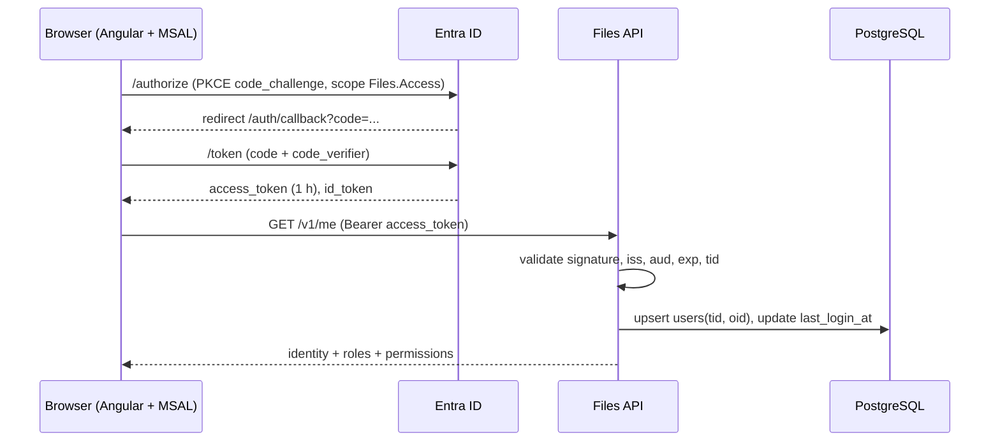

# Microsoft Entra ID Authentication Design

**Decisions:** ADR-0004 · **Requirements:** FR-ID-001..011 · **Open items:** OQ-01 (mail), OQ-03 (multi-tenant)

## 1. App registrations

| Registration | Platform | Purpose | Secrets |
|---|---|---|---|
| `files-api` | Web API (expose an API) | Resource/audience for all tokens. Defines scope and app roles. | Optional client secret only for local tooling; not used by the API. |
| `files-portal` | Single-page application | Angular SPA. Redirect URIs per environment. | **None** (public client, PKCE). |
| `files-integration-<name>` | Web (confidential) or none | One per consuming application, for client credentials. | Client secret or certificate held by the consumer. |

### `files-api` configuration

- **Application ID URI:** `api://<files-api-client-id>` (or verified domain form).
- **Exposed scope:** `Files.Access` — "Access Files API as the signed-in user", admin consent
  granted, enabled.
- **App roles** (Enterprise Application → App roles):

| Display name | Value | Allowed member types | Purpose |
|---|---|---|---|
| Files User | `Files.User` | Users/Groups | Portal access. Assigned by default to a security group containing all employees. |
| Files Admin | `Files.Admin` | Users/Groups | Administration. |
| Files Auditor | `Files.Auditor` | Users/Groups | Read-only audit/usage. |
| Files Integration | `Files.Integration` | Applications | Proves the caller is a registered machine app; per-integration permissions live in Files. |

- **Optional claims:** `email`, `upn` (if available), `groups` not required.
- **Token configuration:** v2 access tokens; `roles` included for app roles.
- **Redirect URIs** belong to `files-portal`, not `files-api`.

### `files-portal` configuration

- Platform: **Single-page application**.
- Redirect URIs: `https://files.sacservices.cloud/auth/callback`,
  `http://localhost:4200/auth/callback` (dev only).
- Front-channel logout URL: `https://files.sacservices.cloud/auth/logout` (optional).
- API permissions: `Files.Access` (delegated), `openid`, `profile`, `email`; admin consent granted.
- No client secret, no certificates, no `.default` scope.

### Integration registration

- For each consumer: app registration with **no redirect URI**, client credentials enabled.
- API permission: `Files.Integration` (application permission, admin consent).
- The consumer obtains tokens from `https://login.microsoftonline.com/{tenant}/oauth2/v2.0/token`
  with `scope=api://<files-api-client-id>/.default`.
- Files stores `entra_client_id` on `integrations` (unique). The token's `azp`/`appid` is matched
  to that row; unregistered clients are rejected even with a valid signature.
- Client secrets/certificates are managed by the consumer; Files never stores them.

## 2. Human sign-in flow



- MSAL stores tokens in `sessionStorage`; the SPA never handles refresh tokens.
- Silent renewal uses a hidden iframe or refresh token inside MSAL; on failure, redirect to login.
- The API is stateless; there is no server session or cookie.
- Sign-out: MSAL `logoutRedirect` to `https://login.microsoftonline.com/{tid}/oauth2/v2.0/logout`
  with `post_logout_redirect_uri` allowlisted in the app registration.

## 3. Token validation

Use `Microsoft.Identity.Web` (preferred) or `JwtBearer` configured as follows:

| Check | Value |
|---|---|
| Authority | `https://login.microsoftonline.com/{tenantId}/v2.0` |
| Metadata | OpenID configuration + JWKS, cached |
| Audience | `api://<files-api-client-id>` (accept the client ID GUID only if required by token version) |
| Issuer | `https://login.microsoftonline.com/{tenantId}/v2.0` |
| Signing | RS256; keys from JWKS; `RequireSignedTokens = true` |
| Lifetime | `exp`/`nbf` with ≤2 min clock skew |
| Tenant | `tid` claim must equal `Entra:TenantId` (defense in depth beyond issuer) |
| Token type | Delegated: `scp` contains `Files.Access`. App-only: `idtyp = app` and `roles` contains `Files.Integration`. |
| Algorithms | Reject `none`, HS*, and unexpected `alg` values. |

Failures return `401 invalid_token`, `401 tenant_not_allowed`, or `401 token_expired`; details are
logged without the token.

### Actor classification

```
if token has scp containing Files.Access and idtyp != app  -> human
else if idtyp == app and roles contains Files.Integration  -> integration
else -> reject
```

Human endpoints reject app-only tokens even if they carry `Files.Admin` (app role assignments to
applications are not user roles). Integration endpoints reject delegated tokens.

## 4. Claims mapping

| Claim | Use |
|---|---|
| `tid` | Tenant check; stored on `users`. |
| `oid` | Immutable user object ID; stored on `users.object_id` (identity key). |
| `preferred_username` / `upn` / `email` | Notification recipient; stored as `users.email` (prefer `preferred_username` if it contains `@`). |
| `name` | Display name. |
| `roles` | Portal role evaluation (`Files.User`, `Files.Admin`, `Files.Auditor`). |
| `azp` / `appid` | Integration lookup for app-only tokens. |
| `oid` of app token | Service principal object ID (stored for audit if configured). |
| `scp` | Proves delegated scope. |
| `idtyp` | Distinguishes app-only tokens. |

**Email change:** updated from the token on each login. Notifications always use the latest value.
If no email claim exists, provisioning succeeds with `email = NULL`; notifications fail
permanently with `no_recipient` (visible in notification events).

## 5. Authorization

- Portal role policies are evaluated from the `roles` claim on every request; roles are never
  cached in the database.
- `Files.Admin` implies user capabilities. `Files.Auditor` grants only audit/usage endpoints.
- No role grants access to another user's file content (D-19).
- Resource authorization (ownership, link validity, integration grants) happens in the
  application layer, after authentication.
- Admin API endpoints require `Files.Admin`; audit/usage endpoints require `Files.Admin` or
  `Files.Auditor`.

## 6. Private links

- A private link URL (`/d/{token}`) is a portal route. If there is no session, MSAL redirects to
  Entra with a `returnUrl` (validated against an allowlist).
- After login, the SPA calls `POST /v1/download-links/{token}/downloads` with the bearer token.
- The API verifies: valid tenant token, active user, active link, file downloadable, link limits.
- Any tenant member with the link may download (OQ-04 default). The link is the authorization,
  not the user's relationship to the file.
- A user from another tenant is rejected (`401 tenant_not_allowed`), even if the link is valid.
- Guest/B2B accounts: not supported in v1 because `tid` may reflect the home tenant. If guests
  must be supported, add an explicit tenant-membership check (OQ-03/OQ-04).

## 7. Conditional Access, MFA, and session controls

- Entra Conditional Access (MFA, compliant device, location) applies at token issuance; Files
  inherits it without extra code.
- Recommended policies: require MFA for all users, block legacy auth, require compliant device
  for `Files.Admin`.
- Access token lifetime 1 h (default); the API does not extend it. Long-running downloads already
  authorized by a grant are unaffected.
- Sign-in risk and Identity Protection are handled by Entra; Files logs the `oid` and `tid`.

## 8. Configuration

```json
{
  "Entra": {
    "Instance": "https://login.microsoftonline.com/",
    "TenantId": "<tenant-guid>",
    "ApiClientId": "<api-app-guid>",
    "ApiAudience": "api://<api-app-guid>",
    "PortalClientId": "<spa-app-guid>",
    "RequiredScope": "Files.Access",
    "RequireTenantMatch": true,
    "ClockSkewSeconds": 120
  }
}
```

The SPA receives only `tenantId`, `clientId`, `apiScope`, and `apiBaseUrl` via
`/assets/config.json`. No secrets.

## 9. Failure modes

| Condition | Result |
|---|---|
| Entra unavailable | New logins fail; existing tokens valid until expiry; API keeps serving metadata. |
| JWKS fetch failure | Tokens cannot be validated → 401; alert. Keys are cached; outage tolerated for hours. |
| Misconfigured audience | All tokens 401; startup validation checks configuration shape, not Entra. |
| Clock skew | ≤2 min tolerated; NTP/chrony required on the EC2 host. |
| User disabled in Entra | New tokens fail; existing token may work up to 1 h. `users.status` is not synced in v1. |
| Tenant mismatch | 401; logged as a security event. |

## 10. Test plan

- Unit: claim mapping, role evaluation, actor classification, tenant mismatch.
- Integration: signed test JWTs (generated with a test key) for valid/invalid cases; WireMock for
  JWKS; contract tests for 401 shapes.
- E2E: real test tenant (recommended before release) for portal sign-in, private link, admin.
- Security: token replay from another tenant, `alg=none`, expired token, app token on user route.
