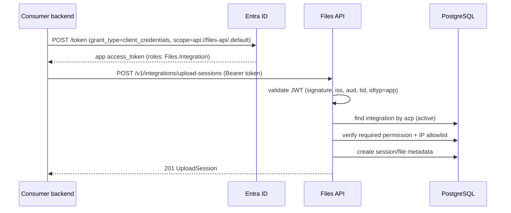

# Machine Identity and Authorization

**Decisions:** ADR-0004, ADR-0011 · **Requirements:** FR-M2M-001..014, FR-INT-001..011

## 1. Registration model

An integration is created by an administrator in two coordinated steps:

1. **Entra:** create/obtain an app registration for the consumer with the application permission
   `Files.Integration` (admin consent). Record its client ID.
2. **Files:** `POST /v1/admin/integrations` with `slug`, `name`, `permissions`, optional
   `entraClientId`, optional IP allowlist. Then issue an API key if the consumer needs the
   fallback (`POST .../credentials` with `credentialType=api_key`).

The integration row stores:

- `status` (`active`/`disabled`) — disabling is immediate for all credential types.
- Permissions (`file.write`, `file.read`, `file.delete`) — replaceable only by an admin, audited.
- `entra_client_id` — unique, matched against the token's `azp`.
- `allowed_ip_cidrs` — optional; empty means any source (still requires a valid credential).
- Disable/enable metadata with reason and actor.

## 2. Primary authentication: Entra client credentials



Rules:

- Tokens are cached by the consumer until near expiry; Files never issues its own JWTs.
- `azp` (or `appid`) must map to exactly one active integration. Unregistered clients get
  `401 invalid_token`; disabled integrations get `401 integration_disabled`.
- The presence of `Files.Integration` proves the app was granted the app role; **permissions are
  always read from the Files database**, not from the token.
- Client secrets/certificates never reach Files. Consumers must use certificates or managed
  identity where possible.

## 3. Fallback authentication: API keys

### Format

```
flk_<kid>_<secret>
    kid    = 12 lowercase base32/base36 chars (lookup index, not secret)
    secret = 32 random bytes, base64url (43 chars)
```

Example (fake): `flk_7k2m9q4xw1ab_Vq3t...43chars`. The full value is 256-bit entropy.

### Storage and verification

- Store `key_id = kid`, `key_prefix = "flk_<kid>_"` (for display), and
  `secret_hash = HMAC-SHA256(pepper, secret)` (32 bytes). The pepper is
  `Auth__ApiKeyPepper`; `hash_key_version` records which pepper version verified
  the hash so peppers can be rotated (runbook §15).
- Authentication: parse → lookup `key_id` → reject if integration disabled/credential
  revoked/expired → verify HMAC in constant time → update `last_used_at` (at most once/minute).
- The plaintext is returned exactly once at issuance; the UI shows it once and never again.
- Keys are never written to logs, traces, URLs, or error messages. Redaction filters include
  `Authorization` and any `flk_` pattern.

### Lifecycle

| Operation | Behavior |
|---|---|
| Issue | Admin selects name, expiry (default 365 days), optional `rotateFromId`. Secret returned once. |
| Rotate | Issue a second key; both are valid during the overlap window (consumer deploys the new one, then revokes the old). |
| Revoke | `revoked_at` set; authentication fails immediately (`401 api_key_expired`). Reason required. |
| Expire | `expires_at` enforced at authentication; alerts 30/7/1 days before. |
| Disable integration | All keys fail regardless of expiry. |

Limits: at most 2 active API keys per integration; 5 credentials per integration total. Exceeding
returns `422 validation_error`.

## 4. Authentication handler selection

```
Authorization header missing                          -> 401
Bearer value starts with "flk_"                      -> ApiKey handler
otherwise                                           -> JWT handler (user or app token)
```

The JWT handler accepts both delegated and app-only tokens; the endpoint's authorization policy
decides which actor types are allowed. API key authentication always resolves to an integration;
the integration policy rejects it on portal routes.

## 5. Permissions and file-level authorization

| Operation | Permission | Ownership/grant |
|---|---|---|
| Create upload session / proxy upload | `file.write` | New file owned by caller. |
| Read metadata | `file.read` | Owned or active `integration_file_grants` row. |
| Check availability | `file.read` | Same. |
| Download content | `file.read` | Same. |
| Delete file | `file.delete` | **Owner only** (grants are read-only). |

Additional rules:

- Grants are created by admins (`POST /v1/admin/files/{fileId}/grants`), can expire, and are
  revocable. A grant never allows deletion or writing.
- Disabled integrations, expired grants, and deleted files fail closed.
- Cross-integration access attempts are audited as denied download events.
- Foreign/unauthorized files return `404 file_not_found` (no existence oracle).

## 6. Per-integration quotas and limits

| Limit | Default | Config |
|---|---|---|
| Max file size | 5 GiB (or lower per integration) | `Storage__MaxFileSizeBytes` + per-integration override |
| Concurrent upload sessions | 5 | `platform_settings.max_upload_sessions_per_integration` |
| Daily ingress bytes | 50 GiB | `daily_usage` |
| Requests per minute | 600 | rate limiter |
| API keys | 2 active | — |

Quota checks happen **before** presigning and are enforced atomically with `daily_usage` upserts.
`429 quota_exceeded` includes `Retry-After` until the next UTC day.

## 7. IP allowlist

- Stored as `cidr[]`; empty = any.
- The API trusts `X-Forwarded-For` only from the ALB and takes the first untrusted hop; direct
  connections are rejected in production by security groups.
- IPv4 and IPv6 supported. `403 ip_not_allowed` is logged with the resolved IP (hashed in audit).
- Changing the allowlist is audited and takes effect immediately.

## 8. Audit events

| Event | Data |
|---|---|
| Integration created/updated/disabled | Admin actor, reason, before/after (no secrets). |
| Credential issued | Key ID, type, expiry, actor; never the secret. |
| Credential revoked/expired | Reason, actor, timestamp. |
| Upload session created/completed | Integration, file ID, size, IP hash. |
| Metadata/content access | Integration, file ID, result, IP hash, trace ID. |
| Access denied | Reason code (`no_grant`, `disabled`, `ip_not_allowed`, `unavailable`). |
| File deleted | Integration actor, prior state, result. |

## 9. Rotation runbook (summary)

1. Issue key B with `rotateFromId = A`; distribute B to the consumer through the approved secret
   channel.
2. Consumer deploys B and confirms successful calls (monitor `last_used_at` and 401 metrics).
3. Revoke A with a reason.
4. If a key leaks: revoke immediately, issue a replacement, review `download_events` and
   `file_audit_events` for the exposure window, notify security.

For Entra client credentials, rotation is managed in Entra: add a new secret/certificate, update
the consumer, then remove the old one; Files needs no change because the integration is keyed by
`azp`.

## 10. Error behavior

| Situation | Status/code |
|---|---|
| Missing header | 401 `invalid_token` |
| Unknown key ID | 401 `api_key_invalid` |
| Wrong secret | 401 `api_key_invalid` |
| Expired/revoked key | 401 `api_key_expired` |
| Disabled integration | 401 `integration_disabled` |
| Valid credential, missing permission | 403 `insufficient_permission` |
| Valid credential, IP outside allowlist | 403 `ip_not_allowed` |
| File not owned/no grant | 404 `file_not_found` |
| File expired/quarantined | 404 `file_unavailable` |
| Quota exceeded | 429 `quota_exceeded` |

## 11. Consumer obligations (documented in the integration guide)

- Store credentials in a secret manager, never in source control or browsers.
- Use client credentials from the backend only; never expose them to a browser.
- Send an `Idempotency-Key` on create operations and retry with the same key.
- Treat 404 as "not accessible" and never retry 4xx except 429.
- Validate the user's business authorization **before** requesting a file; Files enforces only
  file-level access.
- Persist the returned `fileId` alongside the business record; do not store file bytes.
