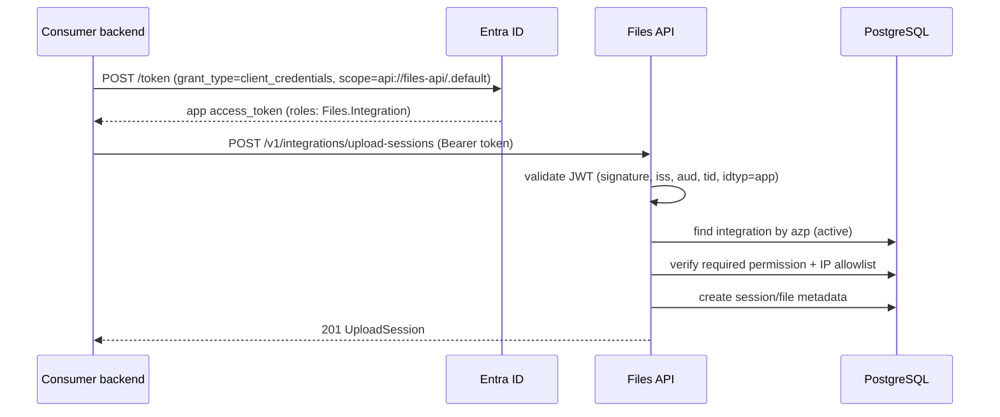

# Machine Identity and Authorization

**Decisions:** ADR-0004, ADR-0011 · **Requirements:** FR-M2M-001..014, FR-INT-001..011

Machine authentication is **Entra ID client credentials only**. Files does not issue API keys,
store client secrets, or accept shared symmetric credentials.

## 1. Registration model

An integration is created in two coordinated steps:

1. **Entra:** the consumer's app registration gets the application permission/role
   `Files.Integration` (admin consent). Record its **client ID** (`appId`).
2. **Files:** an administrator calls `POST /v1/admin/integrations` with `slug`, `name`,
   permissions, optional `entraClientId`, and optional IP allowlist.

The integration row stores:

- `status` (`active`/`disabled`); disabling is immediate.
- Permissions (`file.write`, `file.read`, `file.delete`), admin-managed and audited.
- `entra_client_id` — unique; matched against the token's `azp`/`appid`.
- `allowed_ip_cidrs` — optional; empty means any source (a valid token is still required).
- Disable/enable metadata with reason and actor.

## 2. Client-credentials flow

The API/worker is the only S3 client (D-30); integration credentials authorize API calls, never
S3 calls.

Rules:

- Tokens are cached by the consumer until near expiry; Files never issues its own JWTs.
- `azp`/`appid` must map to exactly one active integration. Unregistered clients get
  `401 invalid_token`; disabled integrations get `401 integration_disabled`.
- The `Files.Integration` role proves the app was granted the API permission; **permissions are
  always read from the Files database**.
- Client secrets/certificates stay in the consumer's secret store; they never reach Files.
  Consumers should use certificates or managed identity where possible.
- No API keys, basic-auth credentials, or shared secrets are accepted.

## 3. Authorization and file access

| Operation | Permission | Ownership/grant |
|---|---|---|
| Create upload session | `file.write` | New file owned by caller. |
| Read metadata | `file.read` | Owned or active `integration_file_grants` row. |
| Check availability | `file.read` | Same. |
| Download content | `file.read` | Same. |
| Delete file | `file.delete` | **Owner only**; grants are read-only. |

- Grants are created by admins (`POST /v1/admin/files/{fileId}/grants`), can expire, and are
  revocable.
- Disabled integrations, expired grants, and deleted/expired files fail closed.
- Cross-integration attempts are audited as denied download events.
- Foreign/unauthorized files return `404 file_not_found` (no existence oracle).

## 4. Per-integration quotas and limits

| Limit | Default | Config |
|---|---|---|
| Max file size | 5 GiB (or lower per integration) | `Storage__MaxFileSizeBytes` + override |
| Concurrent upload sessions | 3 | `platform_settings` / integration |
| Daily ingress bytes | 50 GiB | `daily_usage` |
| Requests per minute | 600 | rate limiter |
| API keys | **not supported** | — |

Quota and staging-capacity checks happen **before** creating a session or accepting any chunk,
and are enforced atomically with `daily_usage` upserts. `429 quota_exceeded` includes
`Retry-After`.

## 5. IP allowlist

- Stored as `cidr[]`; empty = any.
- The API trusts `X-Forwarded-For` only from Caddy and takes the first untrusted hop; direct
  connections to the API port are impossible from the internet.
- IPv4 and IPv6 are supported. `403 ip_not_allowed` is logged with the resolved IP (hashed in
  audit).
- Changing the allowlist is audited and takes effect immediately.

## 6. Audit events

| Event | Data |
|---|---|
| Integration created/updated/disabled | Admin actor, reason, before/after. |
| Entra client ID bound/changed | Admin actor, old/new client ID, reason. |
| Upload session created/completed | Integration, file ID, size, IP hash. |
| Metadata/content access | Integration, file ID, result, IP hash, trace ID. |
| Access denied | Reason code (`no_grant`, `disabled`, `ip_not_allowed`, `unavailable`). |
| File deleted | Integration actor, prior state, result. |

## 7. Credential rotation (consumer-owned)

1. In Entra, add a new client secret/certificate to the consumer's app registration.
2. Deploy the new credential to the consumer; confirm calls succeed.
3. Remove the old secret/certificate in Entra.
4. No Files change is required because the integration is keyed by `azp`/`client ID`.

If an Entra credential leaks: disable the integration in Files immediately (blocks all tokens),
revoke the app secret in Entra, review `download_events`/`file_audit_events`, then re-enable with a
new credential.

## 8. Error behavior

| Situation | Status/code |
|---|---|
| Missing header | 401 `invalid_token` |
| Invalid/expired token | 401 `invalid_token` / `token_expired` |
| Unregistered `azp` | 401 `invalid_token` |
| Disabled integration | 401 `integration_disabled` |
| Valid token, missing permission | 403 `insufficient_permission` |
| IP outside allowlist | 403 `ip_not_allowed` |
| File not owned/no grant | 404 `file_not_found` |
| File expired/quarantined | 404 `file_unavailable` |
| Quota exceeded | 429 `quota_exceeded` |

## 9. Consumer obligations

- Store the Entra secret/certificate in a secret manager; never in source or a browser.
- Use client credentials only from the backend.
- Send an `Idempotency-Key` on create operations and retry with the same key.
- Treat 404 as "not accessible"; never retry 4xx except 429.
- Validate the user's business authorization **before** requesting a file; Files enforces only
  file-level access.
- Persist the returned `fileId` with the business record; do not store file bytes.
