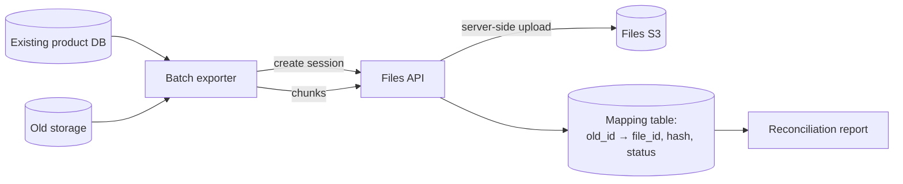

# Migrating Existing Files from the Enterprise Product

**Scope:** moving file contents that currently live in the existing product's repositories or
storage into Files, without breaking customer records or business authorization.
**Related:** §15 of the source spec, [US-019](../01-product/user-stories.md), [integration flow](upload-and-download.md).

## 1. Principles

1. The existing product remains the owner of customer records and business authorization. Files
   owns bytes and file-level access.
2. The stable `fileId` returned by Files is stored next to the customer record; the existing
   product stops storing file contents.
3. Never delete source bytes until the mapping is reconciled and the dual-run window passes.
4. Backfill is idempotent and resumable; re-running a batch must not duplicate files.
5. Integration credentials stay in the existing product backend, never in a browser.

## 2. Ownership decision (required before backfill)

| Option | Behavior | When to use |
|---|---|---|
| **A. Integration-owned** (recommended default) | Files stores the file under the existing product's integration identity, indefinite retention, no portal visibility. Downloads go through the existing product's backend after its business check. | Customer documents whose access must follow the customer-record authorization. |
| B. Human-owned | Files assigns the file to the original uploader (mapped Entra object ID), applies human retention, and may be visible in the portal. | Files must become the user-facing file library and uploader identity is known and reliable. |
| C. Hybrid | Integration-owned + explicit read grants for selected humans/teams. | Portal visibility is needed without giving up the integration boundary. |

Record the choice in `decisions.md`/an ADR if it changes the default. Option A preserves the
current security model with the least risk.

## 3. Phase 0 — Inventory

- Count files, total bytes, size distribution, content types, and duplicates (hash).
- Identify the current storage location(s), retention rules, legal holds, and PII.
- Map business records to files; detect files with no record and records with no file.
- Measure export throughput and API quota headroom (`OQ-13`).
- Define the retention policy for migrated files (integration default = indefinite; if legal
  requires finite, use an admin override and document it).

## 4. Phase 1 — Backfill pipeline

Per file:

1. Read the source bytes and compute SHA-256.
2. Create a mapping row `pending` with `old_id`, size, hash, customer record ID.
3. `POST /v1/integrations/upload-sessions` with
   `Idempotency-Key = "backfill:<old_id>:<hash>"`, file name, size, content type, checksum.
4. Upload the file in chunks to `PUT /v1/integrations/upload-sessions/{id}/chunks/{n}`
   (concurrency ≤2; respect quotas and the 16 MiB chunk size).
5. `POST .../complete`; the API stages/verifies and uploads to S3; verify the returned metadata
   and checksum. No S3 URL or credential is involved.
6. Store `fileId` in the mapping row and update the customer record reference in the same
   application transaction (or a controlled two-step with a reconciliation flag).
7. Mark `done`; on failure, mark `failed` with a reason and retry later with the same idempotency
   key (safe).

Batching:

- Process in deterministic order (customer ID, file ID) with fixed batch sizes (e.g., 100).
- Parallelism: 2–4 files per worker, up to the integration's concurrent-session limit.
- Backoff on 429/5xx; never retry 4xx except 429.
- Pause/resume by batch checkpoint; a full run must be restartable.
- Keep a dead-letter list for files that repeatedly fail; handle manually.

## 5. Validation

- Counts: source files = mapped + intentionally skipped + failed (explain each bucket).
- Every mapped file: `fileId` exists, metadata size matches, checksum matches, file is `available`.
- Sample downloads (1–5%) through the integration API and compare hashes with the source.
- Duplicate detection: identical hashes should map to distinct Files records (each business
  reference needs its own file) or be documented as intentionally deduplicated.
- No customer record points to a missing or failed file.

## 6. Dual-run and cutover

1. **Dual-write:** new uploads go to Files; the old path is still written only if required for
   rollback (ideally not).
2. **Dual-read:** downloads try Files; on a mapping miss, fall back to old storage for a bounded
   period, logging the fallback.
3. **Freeze/verify:** run the final reconciliation; resolve dead letters.
4. **Cutover:** switch reads to Files only; make old storage read-only.
5. **Decommission:** after the agreed safe window (e.g., 30 days) and legal/security sign-off,
   delete old copies per the backup policy and record the decision.

Rollback: keep the mapping and old storage read-only until sign-off; reverting reads is a
configuration switch, not a data migration.

## 7. Operational limits

- Respect per-integration quotas and rate limits; request a temporary increase for the backfill
  window if needed (admin, documented).
- Prefer off-peak windows; monitor `files_upload_bytes_total`, error rates, and S3 throttling.
- Files treats the backfill like any integration: idempotent sessions, audit events, and
  indefinite retention. Admin overrides are audited.
- Large files (>5 GiB) are out of scope; split or raise the limit explicitly before starting.

## 8. Checklist

- [ ] Ownership option chosen and recorded.
- [ ] Retention mapping approved (legal).
- [ ] Inventory and duplicate analysis complete.
- [ ] Mapping table designed with old/new IDs, hash, status, error.
- [ ] Backfill dry run on 100 files; hashes verified.
- [ ] Full run with checkpointing; dead letters resolved.
- [ ] Reconciliation report signed off.
- [ ] Dual-read period completed; fallbacks zero.
- [ ] Old storage read-only, then decommissioned with an audit record.
