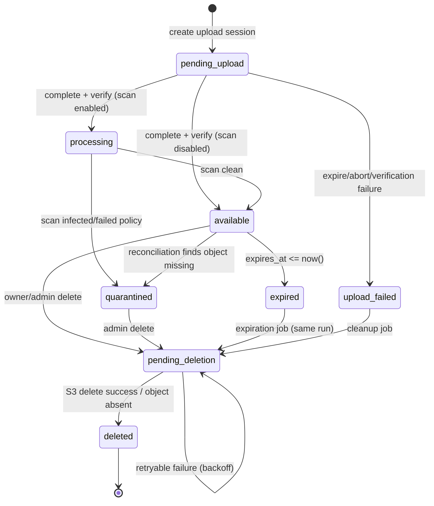

# File Lifecycle and State Machine

**Related:** [data model](../03-data/data-model.md) · [upload/download](upload-and-download.md) ·
[retention/notifications/deletion](retention-notifications-deletion.md)

## 1. States

| State | Meaning | Downloads | Visible in portal | Can transition to |
|---|---|---|---|---|
| `pending_upload` | Upload session created; object not verified. | No | No (or "uploading" if in progress) | `processing`, `available`, `upload_failed`, `pending_deletion` |
| `processing` | Object verified; scanning or post-processing pending. | No | Yes (badge "processing") | `available`, `quarantined` |
| `available` | Verified, downloadable subject to authorization and expiry. | Yes | Yes | `expired`, `pending_deletion`, `quarantined` |
| `quarantined` | Malware/policy violation or missing object. | No | Yes (admin only detail) | `pending_deletion` |
| `expired` | Logical expiry passed. | No | No (filter "expired") | `pending_deletion` |
| `pending_deletion` | Physical deletion queued/retrying. | No | No | `deleted` |
| `deleted` | Object deleted (or confirmed absent); tombstone retained. | No | No | — (terminal) |
| `upload_failed` | Upload expired/aborted/failed verification. | No | No | `pending_deletion` (cleanup) |

`processing` exists only when malware scanning or an extra verification step is enabled; with
scanning disabled, completion goes directly to `available`.

## 2. State diagram



## 3. Transition table

| # | From | Trigger | Guard | To | Side effects (same transaction) |
|---|---|---|---|---|---|
| T1 | — | `POST upload-session` (portal/integration) | Authorized, quota, size/type allowed, staging capacity available | `pending_upload` | Insert file + session, create empty staging file on EBS, audit `upload_created`, outbox. No S3 call. |
| T2 | `pending_upload` | `complete` | All chunks staged; size/type/checksum verified; S3 upload + HeadObject verified | `processing` | Set size, checksum, `available_at=null`, scan pending, delete staging, audit `upload_verified`, outbox `file.uploaded`. |
| T2a | `pending_upload` | `complete` (scanning disabled) | Same | `available` | Set `available_at=now()`, scan `not_scanned`, delete staging, audit, outbox `file.available`. |
| T3 | `processing` | Scan result clean | Scanner completed | `available` | `scan_status=clean`, `available_at=now()`, audit, outbox. |
| T4 | `processing` | Scan result infected/failed | — | `quarantined` | `scan_status=infected/failed`, `quarantine_reason`, revoke links, audit, alert. |
| T5 | `available` | Expiration job | `expires_at <= now()` and no legal hold | `expired` → `pending_deletion` (one run) | Revoke active links, recompute `access_mode` to `owner_only`, cancel pending notifications, audit `expired`, outbox `file.expired`, set `next_deletion_at=now()`. |
| T6 | `available` | Owner/integration delete | Owner (or admin) and permission | `pending_deletion` | `deletion_requested_by`, reason, revoke links, recompute `access_mode`, audit, outbox `file.deletion_requested`, `next_deletion_at=now()`. |
| T7 | `quarantined` | Admin delete | Admin + reason | `pending_deletion` | Audit, revoke links. |
| T8 | `upload_failed` | Cleanup job | Terminal >24 h | `pending_deletion` | Delete any staging file/multipart, audit cleanup. |
| T9 | `pending_deletion` | Deletion job | — | `deleted` | S3 delete (external, idempotent), `deleted_at=now()`, `last_deletion_error=null`, audit `deleted`, outbox. |
| T10 | `pending_deletion` | Deletion failure | 5xx/timeout/throttle | `pending_deletion` | attempts++, backoff `next_deletion_at`, `last_deletion_error`, metric/alert. |
| T11 | `pending_upload` | Session expiry/abort | TTL passed or client abort | `upload_failed` | Delete staging file, abort any S3 multipart, audit, cleanup. |
| T12 | `available` | Reconciliation | Object missing | `quarantined` | `quarantine_reason='object_missing'`, revoke links, alert, audit. |

No transition from `expired`, `quarantined`, `pending_deletion`, or `deleted` back to `available`.
Retention extension is only possible **before** expiry (while `available`).

## 4. Download eligibility predicate

A file is downloadable only when **all** hold:

```sql
status = 'available'
AND (expires_at IS NULL OR expires_at > now())
AND scan_status IN ('clean', 'not_scanned')
AND legal_hold = false            -- reserved for future use; v1 always false
```

Authorization is evaluated additionally:

- **Portal owner:** `owner_user_id = current user`.
- **Integration:** `owner_integration_id = current integration` OR active grant, plus `file.read`.
- **Public/private link:** active link, valid key (public), link limits, then file predicate.

The predicate is evaluated at grant issuance **and** again at stream time, so a file that expires
between the two is not served. A link's validity never overrides the file predicate.

## 5. Actor and reason requirements

| Action | Actor | Reason required |
|---|---|---|
| Upload/complete/abort | Owner | No |
| Rename/tag | Owner/admin | No |
| Retention change within policy | Owner | No |
| Retention change outside policy | Admin | Yes (≥10 chars) |
| Delete own file | Owner | No |
| Delete any file | Admin | Yes |
| Disable integration / revoke credential | Admin | Yes |
| Bulk retention migration | Admin | Yes |
| Quarantine | System | Automatic reason code |

## 6. Concurrency guarantees

- Transitions are optimistic: `UPDATE files SET status=... WHERE id=$1 AND status=$2` and check
  the row count. A lost race is retried or treated as a no-op (idempotent job).
- Expiration vs. download: the stream path re-reads the file row inside the grant redemption
  transaction; a commit order that expires first wins. Downloads already streaming complete
  (they were authorized), but no new grant is issued after expiry.
- Deletion vs. restore: not supported in v1; once `pending_deletion`, the file cannot return.
- Metadata updates use `version` and `If-Match`; lifecycle transitions also bump `version`.

## 7. Invariants by state

| State | `expires_at` | `deleted_at` | Object in S3 | Links |
|---|---|---|---|---|
| `pending_upload` | per retention | null | none (local staging only) | none |
| `processing` | per retention | null | yes | none until available |
| `available` | per retention | null | yes | allowed |
| `quarantined` | per retention | null | yes | revoked |
| `expired` | past | null | yes (until deletion) | revoked |
| `pending_deletion` | past/any | null | maybe | revoked |
| `deleted` | unchanged | not null | no | revoked |
| `upload_failed` | per retention | null | none | none |

## 8. Failure handling

| Failure | State | Recovery |
|---|---|---|
| S3 commit fails after verification | `failed` (session) / `pending_upload` (file) | Retry `complete`; staged bytes are retained. |
| Staging file lost (host issue) | `pending_upload` | Restart session; no S3 object exists yet. |
| Verification mismatch | `pending_upload` (resumable) or `upload_failed` | Fix/re-upload chunks; cleanup removes staging. |
| Scanner unavailable | `processing` | Retry scan; alert if >1 h; files stay unavailable (fail closed). |
| S3 delete fails | `pending_deletion` | Backoff up to 1 h; alert after 15 min; manual runbook. |
| Object missing at download | `available` → `quarantined` via reconciliation | Alert; admin decides delete. |
| DB unavailable | No transition | Jobs retry; downloads fail closed. |

## 9. Metrics and audit per transition

Every transition writes a `file_audit_events` row (`action` = `upload_created`,
`upload_verified`, `scan_completed`, `quarantined`, `expired`, `deletion_requested`, `deleted`,
`deletion_failed`, `retention_changed`, `metadata_updated`) with actor, result, reason, trace ID,
and JSONB metadata (before/after status, size, error class). Counters:
`file_transitions_total{from,to}` and `files_deletion_failures_total`.
