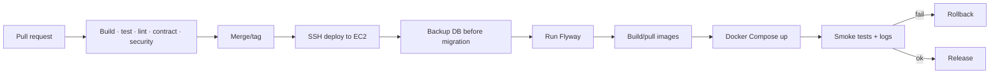

# Deployment and Rollback (Single EC2)

**Related:** [infrastructure](infrastructure-and-iac.md) · [observability](observability-and-slos.md) · [runbooks](runbooks.md)

## 1. Versioning and artifacts

- One Git tag per release (`v1.2.3`); the deployed commit is recorded in `/opt/files/REVISION`.
- Images are built on the EC2 host (or by CI and transferred) and tagged with the Git SHA:
  `files-api:<sha>` and `files-worker:<sha>`. `latest` is never used for production.
- The OpenAPI contract and Flyway migrations are versioned with the code.
- The previous working images/tag stay on the host for rollback (do not prune immediately).

## 2. Pipeline

Stages:

1. **PR:** format, build, unit, integration (Postgres 18 + LocalStack S3), contract, migration,
   static security checks.
2. **Tag/main:** deploy job connects over SSH as the `deploy` user (key restricted in
   `~/.ssh/authorized_keys` to a deployment command if possible).
3. **Backup:** run `deploy/backup.sh` and verify the dump exists in S3 before any migration.
4. **Migrate:** `docker compose run --rm migrator` (Flyway) against the running PostgreSQL; fail
   closed on checksum errors.
5. **Build/pull and start:** `docker compose build` (or pull images), then `up -d` API, worker,
   Caddy. Caddy reloads automatically.
6. **Verify:** run `deploy/smoke.sh`; watch logs, health, error rate, and disk for 15 minutes.

Because there is one API container, a restart causes a brief 502/connection reset. Announce
maintenance windows; Caddy keeps the SPA available while the API restarts.

## 3. First deployment (bootstrap)

1. The host and bucket already exist. Run `deploy/host-bootstrap.sh` once over SSH (Docker +
   directories + swap). Point `files.sacservices.cloud` (Network Solutions) at the host's public IP.
2. SSH as the admin/deploy user; verify Docker, UFW, fail2ban.
3. `git clone` the repository to `/opt/files/app` at the release tag.
4. Create `/opt/files/.env` from `deploy/env.prod.example`; fill secrets (0600).
5. `cd /opt/files/app && docker compose --env-file /opt/files/.env -f deploy/docker-compose.prod.yml up -d postgres`.
6. Run migrations once: `docker compose --env-file /opt/files/.env -f deploy/docker-compose.prod.yml --profile tools run --rm migrator`.
7. Build and start API/worker/Caddy (Compose also starts ClamAV; wait for its health and
   signatures); copy the built SPA to `/var/lib/files/portal`.
8. Install the backup cron/timer; run one backup and verify it in S3.
9. Run `deploy/smoke.sh`; sign in and upload/download a test file.

## 4. Migration policy (expand/contract)

| Change | Release N | Release N+1 |
|---|---|---|
| Add nullable column/table | Add; code reads/writes both | Backfill; enforce NOT NULL |
| Rename column | Add new; dual-write; backfill | Switch reads; drop old |
| Change enum/check | Relax/add; code tolerant | Tighten/remove after cleanup |
| Drop table/column | Stop using | Drop in a later release |

- Migrations must be backward-compatible with the currently running containers (a restart mixes
  versions briefly).
- No long locks on `files`/`download_links`; use `CREATE INDEX CONCURRENTLY` where needed.
- Always take a verified backup before migrating. For destructive changes, a snapshot/dump is a
  release gate.
- Flyway `info`/`validate` before migrate; checksum mismatch stops the deployment.

## 5. Rollback

### Application

1. `git checkout <previous-tag>` in `/opt/files/app` (or use the retained image tag/SHA).
2. `docker compose -f deploy/docker-compose.prod.yml up -d api worker caddy`.
3. Verify health, smoke tests, and logs; the database schema is usually backward-compatible
   because of expand/contract.
4. Record the rollback and root cause.

### Database

- Preferred: forward-fix with a new migration; do not edit applied migrations.
- If a migration caused the incident and the app rollback is insufficient, restore the pre-deploy
  dump:
  1. Stop API/worker.
  2. Restore the dump into a fresh database (`pg_restore --clean --if-exists`).
  3. Point `ConnectionStrings__FilesDb` at it, start containers, verify.
  4. Accept the data loss after the dump timestamp; record it in the incident.
- Never restore over the only copy without first preserving the current database volume.

### Host

- If the host is lost, ask the infrastructure owner for a replacement (or provision a new Ubuntu
  24.04 host), run `deploy/host-bootstrap.sh`, restore the latest dump, redeploy the release, and
  repoint DNS at the new public IP. S3 objects are unaffected.

## 6. Smoke tests (`deploy/smoke.sh`)

- `GET https://$FILES_DOMAIN/health/live` → 200; `/health/ready` → 200.
- `GET /v1/config` → 200.
- Synthesized integration: create a 1 KiB upload session → put one chunk → complete → metadata
  `available` → download content → verify bytes → delete.
- Private link create → grant → stream (test user).
- Admin usage endpoint → 200 (test admin).
- Disk free > reserve; no container restart loop in the last 5 minutes.
- External TLS certificate valid and HTTP redirects to HTTPS.

Production smoke uses a dedicated synthetic integration and deletes its files immediately.

## 7. Release checklist

- [ ] PR approved; required checks green.
- [ ] Changelog/contract diff reviewed (breaking changes? `/v2`?).
- [ ] Migration backward-compatible; rollback/forward-fix documented.
- [ ] `.env` has all required values; no secrets in the diff.
- [ ] Backup verified in S3 immediately before deploy.
- [ ] Staging (if available) or local integration suite passed.
- [ ] Maintenance window announced (brief API restart).
- [ ] Deploy; run smoke tests; watch logs, health, disk, error rate for 30 min.
- [ ] Tag the release; update `REVISION`, roadmap/session log.
- [ ] Verify backup cron and outbox/jobs after the deploy.

## 8. Hotfix

- Branch from the deployed tag, minimal change, same pipeline and tests.
- If no migration is involved, deploy only the affected containers.
- Roll back immediately if the smoke test fails; investigate afterwards.
- Merge the fix back to `main` and re-tag.

## 9. Secrets provisioning

The deploy job writes `/opt/files/.env` atomically (`umask 077`, temp file + `mv`) from GitHub
Environment secrets. Required values: DB password/connection string, Entra tenant/client/audience,
M365 SMTP host/username/password/from mailbox, optional Graph directory app secret, link-key pepper, S3 bucket/region/access-key/secret, SigNoz endpoint.
Never echo the file; never commit it. Rotate via the runbook.

## 10. Incident hooks

- Rollback is allowed before root cause is known if availability is burning.
- Preserve logs (`docker logs`), the failing image/SHA, and the pre-deploy dump.
- Database restore/destructive action requires two approvals.
- Postmortem within 5 business days with action items.
