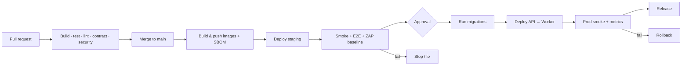

# Deployment and Rollback

**Related:** [infrastructure](infrastructure-and-iac.md) · [observability](observability-and-slos.md) · [runbooks](runbooks.md)

## 1. Versioning and artifacts

- One container image per service per commit: `files-api:<git-sha>` and `files-worker:<git-sha>`.
- `latest` is never deployed. Release tags (`v1.2.3`) point to the same immutable digests.
- The OpenAPI contract and migrations are versioned with the code; a release notes file lists
  contract changes and migration IDs.
- Database migrations are applied by a dedicated ECS task (`flyway` or the migrator image), not by
  API startup.

## 2. Pipeline

Stages:

1. **PR:** format, build, unit, integration (Postgres 18 + LocalStack S3), contract, migration, static
   security. Required checks block merge.
2. **main:** build images with SBOM/provenance, push to ECR, deploy staging, run E2E + ZAP baseline.
3. **Production:** manual approval in the protected GitHub Environment; the approver verifies the
   staging results and the migration/rollback plan.
4. **Migrate:** run Flyway as a one-off ECS task; fail closed on checksum errors.
5. **Deploy API:** new task definition, ECS rolling update with circuit breaker, min healthy 100%,
   max 200%, health check `/health/ready`, deregistration delay 30 s.
6. **Deploy Worker:** new task definition after the API is healthy; it tolerates old/new schema
   during the transition.
7. **Verify:** automated smoke tests, error-rate/latency dashboards for 30 min.

## 3. Migration policy (expand/contract)

Deploy order and compatibility:

| Change | Release N | Release N+1 |
|---|---|---|
| Add nullable column/table | Add, deploy code that reads/writes both | Backfill, then enforce NOT NULL |
| Rename column | Add new, dual-write, backfill | Switch reads, drop old |
| Change enum/check | Relax/add values, deploy code tolerant | Tighten/remove after data cleanup |
| Drop table/column | Stop using, deploy | Drop in a later release |

Rules:

- Migrations must be backward-compatible with the currently running version (rolling deploy mixes
  versions for minutes).
- No long locks on `files`/`download_links`: use `CREATE INDEX CONCURRENTLY` in a
  non-transactional migration; batch backfills.
- Every migration has a forward-fix plan; destructive changes require a backup/snapshot and an
  explicit rollback note.
- Flyway `info`/`validate` runs before migration; on checksum mismatch, stop and investigate.

## 4. Rollback

### Application

1. Identify the last known-good task definition revision (or image tag).
2. `aws ecs update-service --cluster ... --service files-api --task-definition <revision>` (same
   for worker) or re-run the pipeline for the previous tag.
3. ECS circuit breaker automatically rolls back a failed deployment; verify events.
4. Confirm `/health/ready`, run smoke tests, watch 5xx/latency for 15 min.

### Database

- **Preferred:** forward-fix with a new migration; rollback of DDL is rarely safe.
- If a migration caused the incident and is backward-compatible, roll back the app first, then
  write a corrective migration.
- **Last resort:** restore PITR to a new instance and repoint the app; this loses writes after the
  restore point and requires an incident decision. Document the chosen restore timestamp.

### Feature flags

- `Features__PublicLinks`, `Features__MalwareScanning`, quotas, and limits are env/DB-driven and
  can be disabled without a deploy. No dark-launch framework in v1.

## 5. Smoke tests (post-deploy)

Automated (`scripts/smoke.sh` or the pipeline job):

- `GET /health/live` → 200, `/health/ready` → 200.
- `GET /v1/config` → 200 with expected max size.
- Auth: a test user/integration can `GET /v1/me` / list owned files.
- Upload a 1 KiB file via upload session → complete → metadata `available` → download via grant →
  count increments.
- Create + redeem a private link (test token) → 201 grant.
- Admin: `GET /v1/admin/usage` → 200; `GET /v1/admin/retention-policy` → active policy.
- Metrics: `up`, error rate < 1%, no new 5xx in 5 min.

Run against staging with dedicated test accounts; production smoke uses a dedicated synthetic
integration and files that are deleted immediately.

## 6. Release checklist

- [ ] PR approved; required checks green.
- [ ] Changelog/contract diff reviewed (breaking changes? `/v2`?).
- [ ] Migration is backward-compatible; rollback/forward-fix documented.
- [ ] Secrets/config present in the target environment; no secrets in the diff.
- [ ] Backup exists (RDS snapshot or PITR window) for destructive migrations.
- [ ] Staging deployed and E2E/ZAP passed; SLOs normal for 24 h.
- [ ] On-call aware; maintenance window if user-facing risk.
- [ ] Deploy; run smoke tests; watch dashboards for 30 min.
- [ ] Tag the release; update `docs/09-delivery/roadmap.md` progress if a milestone closed.
- [ ] Post-deploy: verify notifications/jobs, outbox lag, deletion queue.

## 7. Hotfix

- Branch from the deployed tag, minimal change, same pipeline (no shortcut around tests).
- If migrations are not involved, deploy the image only.
- After the fix, merge back to `main` and verify staging.

## 8. Environment configuration differences

| Setting | dev | staging | prod |
|---|---|---|---|
| `Features__MalwareScanning` | false | true | true |
| `Features__PublicLinks` | true | true | policy-controlled |
| Log level | Debug | Information | Information/Warning |
| OTel sampling | 100% | 50% | 10% (tail for errors) |
| Autoscaling | 1 task | 2 | 2–8 |
| E2E test accounts | mock Entra | test tenant | synthetic integration |

## 9. Incident response hooks

- Rollback is an operational action; the incident commander may roll back before root cause is
  known if the SLO is burning.
- Preserve logs/traces and the failing task definition revision for the postmortem.
- Database restore or destructive action requires two approvals (engineering + security).
- Post-incident: blameless postmortem within 5 business days, action items tracked.
